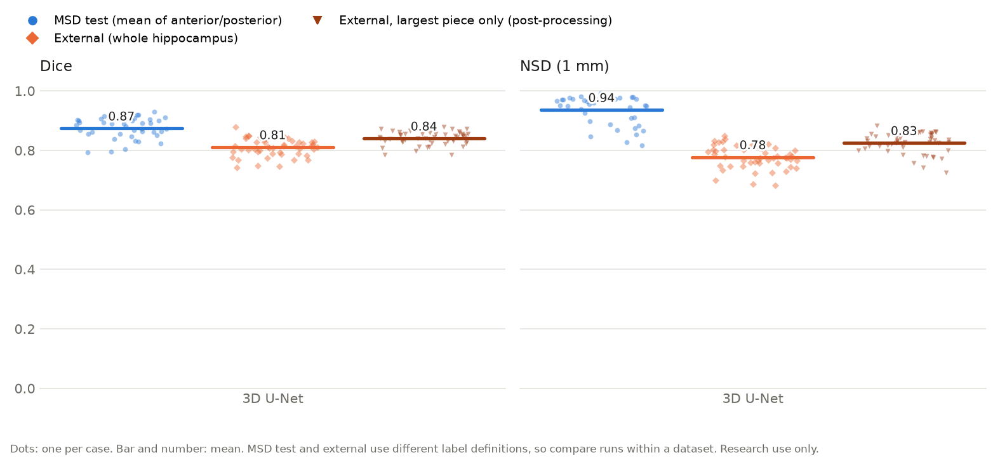
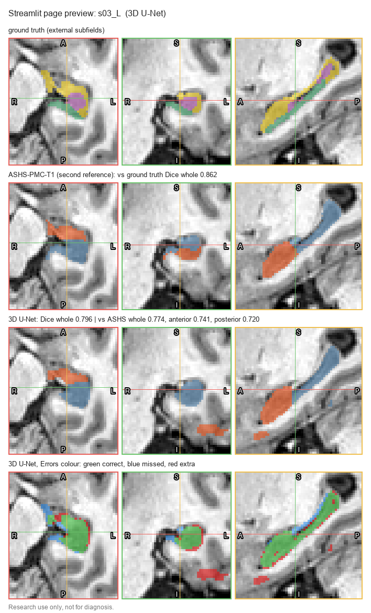

# Hippocampus Volumetry on 3D MRI

A research pipeline that segments the hippocampus (anterior and posterior parts) on 3D T1 MRI, measures its volume, and reports how much the model can be trusted on each scan.

> **Intended use:** research and education only. This software is not a medical device, has not been clinically validated, and must not be used for diagnosis or any clinical decision.

## Status

| Step | What | Status |
|---|---|---|
| 1 | 3D U-Net on MSD Task04, evaluated with Dice and NSD (1 mm), as in the [Medical Segmentation Decathlon](https://www.nature.com/articles/s41467-022-30695-9) | Done |
| 1b | External check on MNI-HISUB25 (25 healthy adults): whole-hippocampus Dice 0.811, NSD 0.777, vs 0.897 / 0.959 on MSD test; independent ASHS-PMC-T1 check on 2 subjects. See [Conclusion](#conclusion-first-iteration) and [docs/external_validation.md](docs/external_validation.md) | First iteration done |
| 2 | Uncertainty: MC dropout and a small ensemble; flag low-confidence cases | Next |
| 3 | DICOM ingest: de-identify, convert to NIfTI, automatic image QC | Planned |
| 4 | Cross-site check on IXI (three hospitals): volume distributions per site and vs. age | Planned |
| 5 | FastAPI service in Docker, CI | Planned |
| 6 | Model card, risk table | Planned |

## Data

[MSD Task04 Hippocampus](http://medicaldecathlon.com/): 3D T1 MPRAGE crops around the hippocampus from Vanderbilt University Medical Center, labels 0 = background, 1 = anterior, 2 = posterior. License CC-BY-SA 4.0.

MSD's own test set has no public labels, so the labelled cases are split 70/15/15 into train/validation/test. The split is by file, because MSD does not say which files come from the same person (see [Limitations](#limitations)).

**External check (MNI-based external dataset):** [MNI-HISUB25](https://www.nitrc.org/projects/mni-hisub25/), downloaded from NITRC (Kulaga-Yoskovitz et al., *Scientific Data* 2015; CC BY-NC-SA 3.0): whole-brain 3T T1 scans of 25 healthy adults in MNI space, with manual hippocampal labels on both sides. Each hippocampus is cut out as a box centred on the dataset's own probability atlas, never on the subject's label. Not used for training.

## Results: in-distribution vs external (3D U-Net)



| Test set | Scored as | Dice | NSD (1 mm) | Cases |
|---|---|---|---|---|
| MSD test (in distribution) | anterior | 0.880 ± 0.035 | 0.931 ± 0.059 | 39 |
| MSD test (in distribution) | posterior | 0.868 ± 0.039 | 0.942 ± 0.047 | 39 |
| MSD test (in distribution) | mean of anterior and posterior | 0.874 | 0.936 | 39 |
| MSD test (in distribution) | whole hippocampus | 0.897 | 0.959 | 39 |
| MNI-HISUB25 (external) | whole hippocampus | **0.811 ± 0.030** | **0.777 ± 0.038** | 50 (25 subjects × left/right) |
| MNI-HISUB25 (external), largest connected piece only | whole hippocampus | 0.840 ± 0.022 | 0.825 ± 0.034 | 50 |

- **Which rows to compare:** the external labels can only be scored as the whole hippocampus (see below), so the fair comparison is the second row against the third. The figure shows MSD the way it is usually reported (mean of the two parts).
- **Left vs right:** external Dice is 0.807 on the left and 0.815 on the right (no difference, p = 0.49).
- **Figure:** each dot is one case and the bar is the mean. Made with `python -m hippo.metrics_plot --runs runs/baseline --names "3D U-Net" --datasets internal external external_largest --out docs/figures/baseline_msd_vs_external`. The dark orange triangles are the external hippocampi after keeping the largest piece (from `python -m hippo.external ... --largest-piece`).
- **Main result has no shift or post-processing.** The last row keeps only each prediction's largest connected piece, which removes the stray islands. It improves all 50 hippocampi (Dice 0.811 → 0.840, NSD 0.777 → 0.825), but that step was chosen after looking at the external errors, so it is reported only as a secondary result.

Full analysis: [docs/external_validation.md](docs/external_validation.md).

## Quickstart

```bash
python -m venv .venv && source .venv/bin/activate      # Windows: .venv\Scripts\activate
pip install -r requirements.txt
# Optional on NVIDIA GPUs: install the CUDA build of PyTorch from pytorch.org first.

export PYTHONPATH=src                                  # Windows PowerShell: $env:PYTHONPATH="src"
python -m hippo.data                                   # downloads ~30 MB and writes data/splits.json
python -m hippo.train --config configs/baseline.yaml   # add --epochs 5 for a quick check
python -m hippo.evaluate --run runs/baseline
mlflow ui                                              # browse runs at http://127.0.0.1:5000
```

### Dataset location

By default the data goes in `./data`. To keep it elsewhere, set the location once instead of passing it to every command. All scripts use the first of these that is set:

1. `--data-dir /path/to/data` on the command line
2. the `HIPPO_DATA_DIR` environment variable
3. `data-dir = /path/to/data` in `hippo.conf` (project root) or `~/.hippo.conf`; copy `hippo.conf.example` to start
4. the default in `src/hippo/defaults.py`

`train` saves the location it used into the run folder, so `evaluate` finds the same data without being told.

Outputs in `runs/baseline/`: `best.pt`, `history.json`, `metrics_test.csv` (one row per case: Dice, NSD, predicted and true volume in ml) and `summary_test.json` (mean, median, std). A test case whose ground truth has no anterior or no posterior label is still predicted, but it can't be scored: its Dice and NSD are left blank and the summary lists it under `dropped`. With `labels: clean`, such cases are left out of training and validation.

Hardware: the crops are about 35×50×35 voxels, so training fits comfortably on a 4 GB GPU and also runs on CPU.

## Tests

```bash
python -m pytest -q
```

The tests check the metrics on hand-made cases and run the whole pipeline (split → train → evaluate) on a small synthetic dataset with the same folder layout as MSD.

## Design notes

- **Metrics match the challenge:** Dice and Normalized Surface Dice with the 1 mm tolerance clinicians chose for this task, so results are comparable with published MSD numbers.
- **Augmentation:** random affine, intensity changes and noise. Flips are left–right only, because flipping front-to-back would swap the anterior and posterior labels.
- **Dropout is kept in the model** so that step 2 can use it for MC-dropout uncertainty without retraining a different architecture.

## Limitations

- **Possible subject overlap between train and test.** MSD Task04 gives no subject IDs, so the split is by file. Neighbouring files (`2k-1` and `2k`) may be the left and right hippocampus of one person, but the dataset does not document this. If they are, 22 of the 39 test cases have their possible partner in the training set, and test Dice and NSD may be optimistic. The external dataset (different subjects) gives an independent check.
- **No subject or side information in MSD.** MSD Task04 gives no subject ID and does not say whether a crop is the left or right hippocampus. It also has no age, sex, diagnosis or scanner details per scan. The image positions are reset, so the crop's place in the head can't be recovered either. Its `dataset.json` only says "Left and right hippocampus segmentation" from Vanderbilt University Medical Center. As a result:
  - the split can only be by file, not by person;
  - results can't be compared between left and right, or between groups (e.g. healthy vs patients);
  - shape comparisons with other datasets can't separate the inner from the outer side.

  The 390 files fit one left and one right hippocampus for each of 195 people, but which files belong together is not recorded.
- **The external labels divide the hippocampus differently, so the external score is not a pure measure of the model.**
  - **Different parts:** MSD labels two parts, **anterior and posterior**: the hippocampus cut once, front from back. MNI-HISUB25 labels three parts, **CA1-3, the subicular complex and CA4-DG**: tissue layers that each run along most of the length (CA1-3 covers 95% of it, subiculum 84%, CA4-DG 55%). No external part matches "anterior" or "posterior", so only the whole hippocampus can be compared, and **the model's anterior/posterior split cannot be checked on this dataset**.
  - **Different outer boundary:** both sets of parts add up to a whole hippocampus (one connected piece in every case), but not the same one. MSD includes "the hippocampus proper and parts of the subiculum". MNI-HISUB25 also includes the thin **inner (medial) extensions**: the tip of the subiculum, the uncus and a thin strip along the tail. The model, trained on MSD, does not draw these. Its inner edge stops about 3 mm short, and in 4,663 inner columns the label has tissue where the prediction has none (386 on the outer side). Its front edge also reaches about 4 mm further.
  - **What this means for the score:** some of the external Dice lost (0.811 vs 0.897 on MSD) comes from disagreeing about what counts as hippocampus, not from the model failing to find it. On MSD itself, the prediction's centre matches the label's within 0.05 mm.
  - **Why the predictions are not shifted:** the prediction's centre is offset from the label's in the same direction in every subject, which looks like a shift. But it is a difference in shape (extra label tissue on one side), not position. Shifting the predictions to match lowered Dice from 0.840 to 0.794 on held-out subjects (47 of 50 worse).
  - **Not the subiculum as a whole:** removing the whole subiculum part from the external label makes the match much worse (0.671), so the model does include the subiculum. Only its thin inner extensions differ, and no label part can simply be dropped to make the two protocols agree.
  - **Other limits:** the label part names are inferred from the atlas; volumes are in MNI space; 25 healthy adults from one site and scanner; one training seed.

## Next steps

1. **Independent check with ASHS: done.** The external labels are correct; the gap comes from MSD's training labels, which leave out the inner tissue, not from an error in the external ground truth. See the [Conclusion](#conclusion-first-iteration).
3. **Fine-tuning on external labels: deferred.** It would use up the only external test set and still build on MSD's incomplete training labels.
4. **Next branch: full-image training on a new dataset with whole-hippocampus labels**,
Details in [docs/external_validation.md](docs/external_validation.md).

## Conclusion (first iteration)

1. **Why MSD Task04 was used.** It was chosen because of GPU constraints: its small crops (about 35×50×35 voxels) train comfortably on a small GPU. The cost is that **its labels do not cover the whole hippocampus**. They include "the hippocampus proper and parts of the subiculum" and leave out the thin inner extensions (subicular tip, uncus, the strip along the tail). Across all labels, MSD hippocampi are 3–5 mm narrower and 2–3 mm lower than the external labels at the same length (39 vs 38 mm).
2. **In distribution the model works well:** Dice 0.874 / NSD 0.936 (mean of anterior and posterior), 0.897 / 0.959 for the whole hippocampus, on 39 MSD test cases.
3. **An independent model confirms the label difference.** ASHS-PMC-T1, run on the whole-brain T1 of s03 and s17 (4 hippocampi), lands on the external manual labels: its centre is within 0.8 mm of theirs. The model's centre is 1.8–3.3 mm off, always outwards, forwards and lower, because it draws MSD's narrower hippocampus. So the external labels are in the right place, and the offset comes from what the model was taught.
4. **The anterior/posterior split agrees reasonably with ASHS:** Dice 0.80 (anterior) and 0.74 (posterior) on the same 4 hippocampi. The model puts the front/back boundary 2–6 mm further forward than ASHS does; MSD's exact boundary rule is not published, so neither is "right". For the whole hippocampus against the manual labels, the model after largest-piece post-processing matches ASHS (0.841 vs 0.840; plain model 0.808).
5. **Accurate out-of-distribution metrics are not possible yet.** No public dataset labelled with MSD's anterior/posterior protocol was found. MNI-HISUB25 uses three subfields and a wider outline, so its Dice of 0.811 mixes model error with the protocol difference. ASHS cannot be run on MSD to check MSD's protocol directly: it needs a whole-head scan, and on two MSD crops it failed once and returned an empty segmentation once.
6. **Other findings:**
   - Most external islands come from the larger, differently placed external box (12 mm of tissue below the hippocampus vs about 5 mm in MSD crops). Keeping the largest piece removes them (0.811 → 0.840), but it is a secondary result.
   - The predictions must not be shifted to fit the labels: on held-out subjects that lowered Dice from 0.840 to 0.794 (47 of 50 worse).
   - Left and right perform the same (0.807 vs 0.815, p = 0.49).
   - The model reacts to unfamiliar surroundings (a zero border lowered MSD Dice from 0.874 to 0.833), which full-image training should remove.
7. **Next experiment: a different training dataset.** Because MSD's labels do not cover the whole hippocampus, the next branch will train on a different dataset with whole-hippocampus labels on whole-head scans, so that training, external tests and tools such as ASHS all see the same kind of image. The GPU limit will be handled with patch-based training (random patches from full images) instead of pre-cut crops. Anterior/posterior labels would then come from that dataset's own protocol or from a stated rule, compared again with ASHS.

These are results on 2 small datasets and one training seed; the ASHS check covers 4 hippocampi, too few for a p-value.

## Viewing results in Streamlit

```bash
PYTHONPATH=src .venv/bin/streamlit run streamlit_dashboard/compare_slices.py     # then open http://localhost:8501
```



*Preview for external hippocampus s03_L, top to bottom:*
- *manual label (gold, green and purple subfields);*
- *ASHS-PMC-T1 as the second reference (orange anterior, blue posterior);*
- *the 3D U-Net's prediction;*
- *its errors against the manual label: green correct, blue missed, red extra. The red patch below the hippocampus in the coronal view is one of the islands that "largest piece only" removes.*

*Drawn with the page's own slice code by `PYTHONPATH=src .venv/bin/python streamlit_dashboard/make_preview.py`; it is not a browser screenshot.*

- **What it shows:** pick an MSD or external crop and one or more runs. You get one row per mask: ground truth, an optional second reference, then each run. Each row has axial, coronal and sagittal views, moved together by the plane sliders in the sidebar.
- **Colours:** **Labels** shows anterior (orange) and posterior (blue), or the external subfields. **Errors** shows correct (green), wrong part (yellow), missed (blue) and extra (red). Row titles give Dice.
- **Display options:**
  - **3D surfaces:** rotatable surfaces; hovering shows the position in mm and the matching slice numbers.
  - **Largest piece only:** applies the post-processing.
- **ASHS:** for s03 and s17, the ASHS anterior/posterior labels are picked automatically as the **Second reference**. Each run's title then also gives its Dice against ASHS.

## Structure

```
configs/baseline.yaml   experiment settings
src/hippo/defaults.py   default paths, shared command-line options
src/hippo/data.py       download, splits, transforms, loaders
src/hippo/model.py      3D U-Net (MONAI)
src/hippo/metrics.py    Dice, NSD, volumes
src/hippo/train.py      training loop, MLflow logging
src/hippo/evaluate.py   per-case test metrics and summary
src/hippo/external.py   external dataset: atlas-centred crops, whole-hippocampus scores
src/hippo/metrics_plot.py  Dice/NSD figure and table per run and dataset
streamlit_dashboard/    Streamlit page (compare_slices.py: slices and 3D surfaces of predictions vs labels, and ASHS)
                        and make_preview.py (the README preview image)
docs/                   external validation report and README figure
tests/                  unit and end-to-end tests
```
