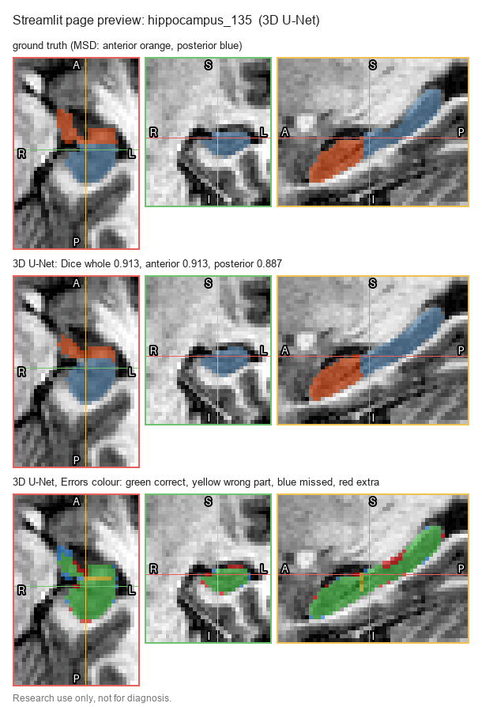
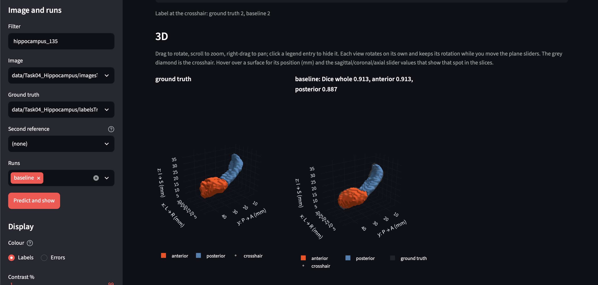
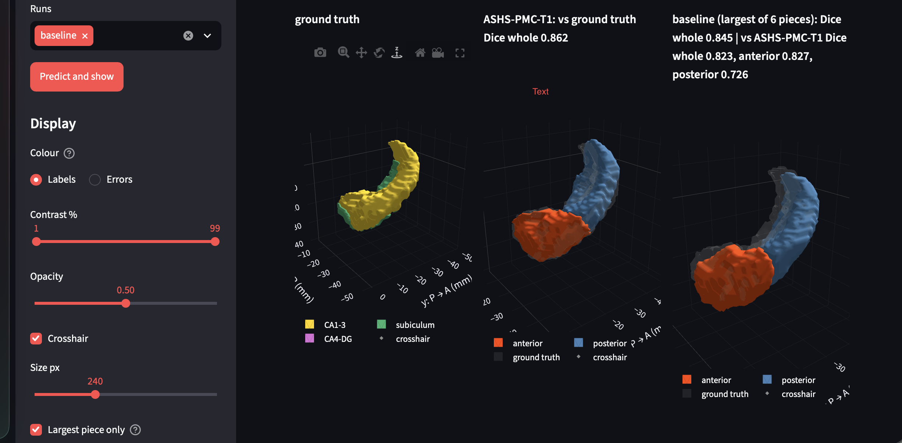
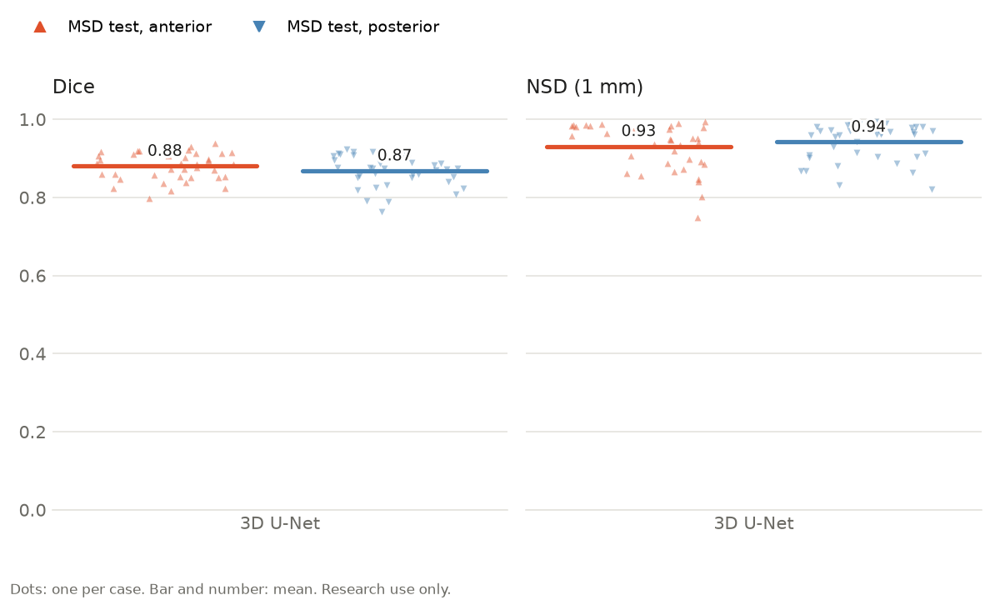
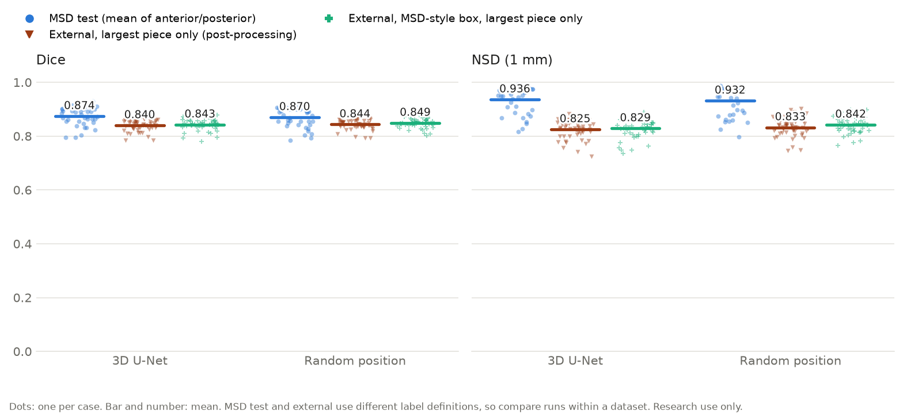
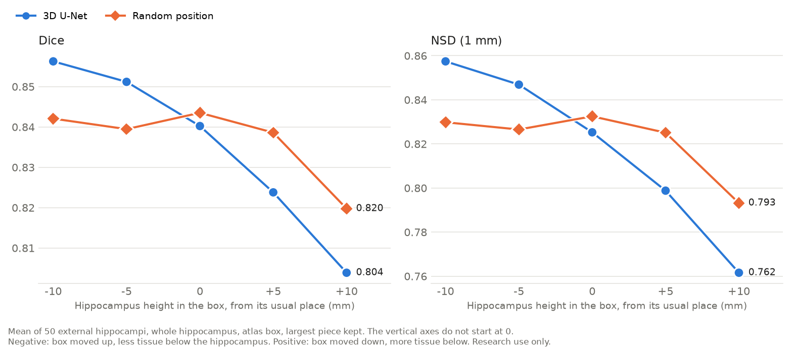

# Hippocampus Segmentation and Volumetry on 3D MRI

**Quick links:**
- **Figures:** [MSD test per part](docs/figures/msd_test_parts.png), [Dice and NSD, MSD test vs external](docs/figures/baseline_msd_vs_external.png) ([table](#results)), the retraining experiment ([scores](docs/figures/random_trim_scores.png), [position curve](docs/figures/random_trim_position_curve.png)) and the Streamlit dashboard previews ([MSD test](docs/figures/streamlit_preview_msd.png), [external](docs/figures/streamlit_preview.png)).
- **Streamlit dashboard:** [how to run it](#viewing-results-in-streamlit). It runs locally at http://localhost:8501.
- **Write-ups:** [Conclusion](#conclusion-first-iteration), the [external validation report](docs/external_validation.md) and the [retraining experiment](docs/retraining_plan.md).

A research pipeline that outlines the hippocampus on 3D T1-weighted MRI with a 3D U-Net, splits it into an anterior and a posterior part, and measures the volume of each part.

> **Intended use:** research and education only. This software is not a medical device, has not been clinically validated, and must not be used for diagnosis or any clinical decision.

**Contents:**
1. [What the model predicts](#what-the-model-predicts)
2. [Viewing results in Streamlit](#viewing-results-in-streamlit)
3. [Input data: what goes in and where it comes from](#input-data-what-goes-in-and-where-it-comes-from)
4. [How the model was trained and validated](#how-the-model-was-trained-and-validated)
5. [Results](#results)
6. [Known limitations](#known-limitations) and [future improvements](#future-improvements)
7. [Load the model and evaluate it](#load-the-model-and-evaluate-it)
8. [Retrain, re-evaluate and save the latest model](#retrain-re-evaluate-and-save-the-latest-model)
9. [Tests](#tests), [project structure](#project-structure), [conclusion](#conclusion-first-iteration)

## What the model predicts

- **Input:** one 3D T1-weighted MRI crop around **one** hippocampus (left or right), at 1 mm voxels, about 35 × 50 × 35 voxels.
- **Output:** a 3D mask on the same voxel grid, where each voxel is labelled:
  - `0` = background
  - `1` = **anterior** hippocampus (the front part, the "head")
  - `2` = **posterior** hippocampus (the back part: body and tail)
- **Derived measurements:** the volume of each part in ml (voxel count × voxel volume). The evaluation also reports how well the mask matches a manual label (Dice and NSD, see [below](#how-the-model-was-trained-and-validated)).

The model is a MONAI 3D U-Net (`src/hippo/model.py`). It does not diagnose anything: it only outlines the structure.

## Viewing results in Streamlit

The dashboard shows a scan, its manual label and the model's prediction slice by slice (axial, coronal, sagittal) and in 3D, with Dice in each row title.

```bash
PYTHONPATH=src .venv/bin/streamlit run streamlit_dashboard/compare_slices.py     # then open http://localhost:8501
```

It needs a trained model in `runs/` and the data in `data/` (see [Load the model](#load-the-model-and-evaluate-it)).

### In distribution: MSD test

**Slices** (test case hippocampus_135):



*Rows, top to bottom: MSD label (orange anterior, blue posterior); 3D U-Net prediction (Dice whole 0.913, anterior 0.913, posterior 0.887); errors per part (green correct, yellow wrong part at the front/back boundary, blue missed, red extra). Plain prediction, no post-processing.*

**3D surfaces** (same test case):



*Left: MSD label. Right: 3D U-Net prediction, with the label as a grey ghost (Dice whole 0.913, anterior 0.913, posterior 0.887). Plain prediction, no post-processing.*

### External: MNI-HISUB25

**Slices** (case s03_L):


*Rows, top to bottom: manual label (gold CA1-3, green subiculum, purple CA4-DG); ASHS-PMC-T1 as the second reference (orange anterior, blue posterior; Dice 0.862 vs the manual label); 3D U-Net prediction (Dice 0.796); errors vs the manual label (green correct, blue missed, red extra). The red patch below the hippocampus in the coronal view is one of the islands that "Largest piece only" removes.*

**3D surfaces** (same case, "Largest piece only" ticked):



*Left to right: manual label; ASHS-PMC-T1; 3D U-Net largest piece, with the manual label as a grey ghost (Dice 0.845 vs the manual label; vs ASHS 0.823 whole, 0.827 anterior, 0.726 posterior).*

*The slice figures are drawn with the page's own code by `streamlit_dashboard/make_preview.py` (`--case hippocampus_135 --out docs/figures/streamlit_preview_msd.png` for MSD); the 3D figures are browser screenshots.*

**Using the page:**

- **What it shows:** pick an MSD or external crop and one or more runs. You get one row per mask: ground truth, an optional second reference, then each run. Each row has axial, coronal and sagittal views, moved together by the plane sliders in the sidebar.
- **Colours:** **Labels** shows anterior (orange) and posterior (blue), or the external subfields. **Errors** shows correct (green), wrong part (yellow), missed (blue) and extra (red). Row titles give Dice.
- **Display options:**
  - **3D surfaces:** rotatable surfaces; hovering shows the position in mm and the matching slice numbers.
  - **Largest piece only:** applies the post-processing, for external crops only (where the islands are). It is greyed out for MSD images, whose results always use the plain prediction.
- **ASHS:** for s03 and s17, the ASHS anterior/posterior labels are picked automatically as the **Second reference**. Each run's title then also gives its Dice against ASHS.

## Input data: what goes in and where it comes from

This is an image model, so its "features" are the **voxel intensities** of the MRI. No other information goes in: no age, sex, side or scanner details.

### What the model sees

| Input | Meaning | How it is prepared (`src/hippo/data.py`) |
|---|---|---|
| T1-weighted MRI crop | Brightness of each 1 mm voxel. On T1, grey matter (the hippocampus) is mid-grey, white matter brighter, fluid dark | Loaded from NIfTI, turned to **RAS orientation** (x = left→right, y = back→front, z = down→up), **z-scored per scan** (mean 0, standard deviation 1 over non-zero voxels), padded to a multiple of 8 voxels per side |
| Label (training and scoring only) | Manual outline: 0 background, 1 anterior, 2 posterior | Same orientation and padding; never z-scored |

**Why z-scoring matters:** MSD scans come in three very different intensity scales (99th percentile about 100, 1,000 and 400,000). Without per-scan normalisation the model fails on the largest group; a run trained without it (`configs/no_norm.yaml`) does much worse.

### Datasets

| Dataset | Used for | What it contains | Source and licence |
|---|---|---|---|
| **MSD Task04 Hippocampus** | Training, validation, in-distribution test | 260 labelled T1 MPRAGE crops (plus 130 unlabelled) from Vanderbilt University Medical Center; labels anterior/posterior | [Medical Segmentation Decathlon](http://medicaldecathlon.com/) ([paper](https://www.nature.com/articles/s41467-022-30695-9)); CC-BY-SA 4.0. Downloaded by `python -m hippo.data` (~30 MB) |
| **MNI-HISUB25** (MNI-based external dataset) | External test only, never trained on | Whole-brain 3 T T1 of 25 healthy adults in MNI space, manual labels of both hippocampi as three subfields (CA1-3, subicular complex, CA4-DG) | [NITRC](https://www.nitrc.org/projects/mni-hisub25/) (Kulaga-Yoskovitz et al., *Scientific Data* 2015); CC BY-NC-SA 3.0. Download it yourself into `data/mri_dataset/` |
| **ASHS-PMC-T1** | Independent second opinion on 2 external subjects | Automatic anterior/posterior hippocampus labels from a multi-atlas tool | [Cloud ASHS](https://sites.google.com/view/ashs-dox/cloud-ashs/cloud-ashs-for-t1-mri) via the ITK-SNAP Distributed Segmentation Service |

- **MSD split:** MSD's own test files have no public labels, so the 260 labelled cases are split by file into **182 train / 39 validation / 39 test** (70/15/15, seed 42), written to `data/splits.json`.
- **External crops:** each external hippocampus is cut out as a 48 × 56 × 56 mm box centred on the dataset's own probability atlas, never on the subject's label (`python -m hippo.external`), giving 50 crops (25 subjects × left/right).
- **MSD has no metadata:** no subject ID, side, age, sex, diagnosis or scanner per file (see [Known limitations](#known-limitations)).

## How the model was trained and validated

Settings are in `configs/baseline.yaml` (one comment per setting); the loop is `src/hippo/train.py`.

**Model:** MONAI 3D U-Net, 1 input channel, 3 output classes, 4 levels with 16/32/64/128 channels, stride 2, 2 residual units per level, dropout 0.1.

**Training:**
- **Loss:** Dice + cross-entropy (`DiceCELoss`).
- **Optimiser:** AdamW, learning rate 0.001, weight decay 0.00001, cosine learning-rate decay.
- **Schedule:** 150 epochs, batch size 8, seed 42 (deterministic; an interrupted run can be resumed exactly with `--resume`). Mixed precision on NVIDIA GPUs.
- **Augmentation** (training only):
  - random rotation (up to about ±11°) and scaling (±10%), half the time;
  - left–right flip, half the time. Never front–back, because that would swap the anterior and posterior labels;
  - brightness scale and shift (±10%) and Gaussian noise.
- **Hardware:** the crops are small, so it trains on a 4 GB GPU, Apple Silicon (MPS) or CPU. `defaults.pick_device()` picks CUDA, then MPS, then CPU.

**Validation:** every 5 epochs on the 39 validation cases, Dice per part. The weights with the best mean validation Dice are saved as `best.pt` (epoch 105, mean Dice 0.877); the final weights as `last.pt`. All runs are logged with MLflow (`runs/mlflow.db`).

**Testing** (`src/hippo/evaluate.py`), on the 39 test cases the model never saw:
- **Dice:** overlap between prediction and label (1 = identical, 0 = no overlap).
- **NSD (1 mm):** share of the two outlines that lie within 1 mm of each other, the tolerance used by the MSD challenge for this task, so results are comparable with published MSD numbers.
- Both per part (anterior, posterior) and for the whole hippocampus.

**External check** (`src/hippo/external.py`): the same model on the 50 external crops, scored as the whole hippocampus only (prediction > 0 vs label > 0), because the external labels have no anterior/posterior parts. Full analysis in [docs/external_validation.md](docs/external_validation.md).

## Results

> **The 3D U-Net performs best on in-distribution data.** On the MSD test split (39 unseen cases from the same source as the training data), whole-hippocampus Dice is **0.897** and NSD **0.959** (anterior 0.880 / 0.931, posterior 0.868 / 0.942). On the external MNI-HISUB25 data it drops to **0.811 / 0.777** (0.840 / 0.825 after keeping the largest piece). Part of that drop comes from the two datasets labelling the hippocampus differently, not only from model error (see [Known limitations](#known-limitations)).

**In distribution (MSD test, 39 cases), per part:**



The two parts score about the same: anterior Dice 0.880 / NSD 0.931, posterior 0.868 / 0.942.

**In distribution vs external:**


| Test set | Scored as | Dice | NSD (1 mm) | Cases |
|---|---|---|---|---|
| MSD test (in distribution) | anterior | 0.880 ± 0.035 | 0.931 ± 0.059 | 39 |
| MSD test (in distribution) | posterior | 0.868 ± 0.039 | 0.942 ± 0.047 | 39 |
| MSD test (in distribution) | mean of anterior and posterior | 0.874 | 0.936 | 39 |
| MSD test (in distribution) | whole hippocampus | 0.897 | 0.959 | 39 |
| MNI-HISUB25 (external) | whole hippocampus | **0.811 ± 0.030** | **0.777 ± 0.038** | 50 (25 subjects × left/right) |
| MNI-HISUB25 (external), largest connected piece only | whole hippocampus | 0.840 ± 0.022 | 0.825 ± 0.034 | 50 |

- **Which rows to compare:** the external labels can only be scored as the whole hippocampus, so the fair comparison is the MSD "whole hippocampus" row against the external rows. The figure shows MSD the way it is usually reported (mean of the two parts).
- **Left vs right:** external Dice is 0.807 on the left and 0.815 on the right (no difference, p = 0.49).
- **Figures:** each dot is one case and the bar is the mean. The dark orange triangles are the external hippocampi after keeping the largest piece.
- **Main result has no shift or post-processing.** Largest-piece post-processing is applied to the **external dataset only**; all MSD rows and both figures' MSD groups use the plain prediction. Keeping the largest piece removes stray islands and improves all 50 external hippocampi (Dice 0.811 → 0.840, NSD 0.777 → 0.825), but that step was chosen after looking at the external errors, so it is a secondary result.

### Experiment: training with the hippocampus in varying positions

External Dice depends on where the crop box sits around the hippocampus, because MSD crops always centre it. So a second model was trained with one change: each training crop loses 5 voxels in z, split at random between top and bottom, so the hippocampus lands in a different place each time (`configs/random_trim.yaml`). All voxels stay real tissue and the label is never cut. MSD crops leave about 5 mm of tissue above and below the hippocampus, which is enough room, but it only moves the hippocampus about ±2.5 mm from the window centre. Everything else is unchanged, and the success criteria were written down before training ([plan and full results](docs/retraining_plan.md)).

**Outcome: the 3D U-Net stays the main model.** The new model is less sensitive to box position and slightly better on external scans, but it narrowly failed one pre-set criterion and scores slightly lower on MSD.

| Test set | Scored as | 3D U-Net (Dice / NSD) | Random position (Dice / NSD) | Dice change: better / worse cases, p |
|---|---|---|---|---|
| MSD test | mean of anterior and posterior | 0.874 / 0.936 | 0.870 / 0.932 | 13 / 26, p = 0.03 |
| MNI-HISUB25, MSD-style box, largest piece | whole hippocampus | 0.843 / 0.829 | 0.849 / 0.842 | 35 / 15, p = 0.003 |
| MNI-HISUB25, atlas box, largest piece | whole hippocampus | 0.840 / 0.825 | 0.844 / 0.833 | 29 / 21, p = 0.34 |



*Each mark is one case and the bar is the mean. The external "largest piece only" group uses the atlas box. MSD test and external use different label definitions, so compare the two models within a group.*

The MSD-style box is the first prediction's bounding box plus MSD's usual margin, so placing it uses no external labels.

**Moving the atlas box up or down** (50 external hippocampi, largest piece):



*The vertical axes do not start at 0, so small differences look larger than in the figure above. Negative: the box moved up, leaving less tissue below the hippocampus. Positive: the box moved down, leaving more tissue below.*

| Hippocampus height in the box (Dice) | −10 mm | −5 mm | 0 | +5 mm | +10 mm | Range |
|---|---|---|---|---|---|---|
| 3D U-Net | 0.856 | 0.851 | 0.840 | 0.824 | 0.804 | 0.052 |
| Random position | 0.842 | 0.840 | 0.844 | 0.839 | 0.820 | 0.024 |

- **Position sensitivity:** the range across box positions halves, but the average barely moves (0.835 → 0.837). The new model is better when the box sits too low (hippocampus +5 and +10 mm, p < 0.001) and worse where the 3D U-Net already did well (−5 and −10 mm, p < 0.001). That lower best point (0.844 vs 0.856) is the criterion it failed: the limit was a drop of 0.01, and the drop was 0.013.
- **Islands:** volume removed by keeping the largest piece drops from 0.333 to 0.109 ml on the atlas box (lower in 40 of 50, p < 0.001).
- **Missing tissue remains:** on the MSD-style box the model still misses 15.8% of the external hippocampus (17.5% before). Moving the hippocampus during training cannot teach tissue that the MSD labels leave out, so external Dice stays well below MSD's whole-hippocampus 0.897.

**Where the errors changed** (plain atlas box, before keeping the largest piece; mean per external hippocampus, paired over 50 cases):

| Error | 3D U-Net | Random position | Lower / higher in | p |
|---|---:|---:|---:|---:|
| Extra voxels, total | 1.12 ml | 0.91 ml | 38 / 12 | < 0.001 |
| Extra: islands (separate pieces) | 0.33 ml | 0.11 ml | 40 / 9 | < 0.001 |
| Extra: within 1 mm of the label | 0.55 ml | 0.64 ml | 0 / 50 | < 0.001 |
| Missed voxels, total | 0.71 ml | 0.66 ml | 34 / 16 | 0.001 |
| Missed: within 1 mm of the prediction | 0.40 ml | 0.36 ml | 45 / 5 | < 0.001 |
| Missed: chunks more than 1 mm away | 0.31 ml | 0.31 ml | 21 / 29 | 0.93 |

- **Islands:** the new model removes most of the islands below the hippocampus, the error linked to cropping.
- **Missed chunks:** they don't change at all. Most missed voxels are on the inner side (median 86% per hippocampus) and in the subiculum, the tissue MSD's labels leave out.
- **The missed voxels it does recover lie at the edge:** its outline sits slightly wider, which also adds extra voxels at the edge in all 50 hippocampi and further into the tail (0.16 → 0.28 ml).

So the remaining external gap comes from what the training labels contain, not from where the crop is cut.
- **Evidence:** one training seed per model, and the external data has guided earlier decisions, so this is not an independent test.

## Known limitations

- **The training labels do not cover the whole hippocampus.** MSD Task04 was chosen because of GPU limits: its small crops train on a small GPU. But its labels include only "the hippocampus proper and parts of the subiculum" and leave out the thin inner (medial) extensions: the tip of the subiculum, the uncus and a strip along the tail. The model learned exactly that, so it draws a narrower hippocampus than labels that include this tissue. Across all labels, MSD hippocampi are 3–5 mm narrower and 2–3 mm lower than the external ones at the same length (39 vs 38 mm).
- **No external dataset with the same labels.** No public dataset labelled with MSD's anterior/posterior protocol was found. MNI-HISUB25 labels three subfields with a wider outline, so:
  - only the whole hippocampus can be compared, and **the anterior/posterior split cannot be checked against manual labels outside MSD**;
  - the external Dice (0.811) mixes model error with the protocol difference. The model's inner edge stops about 3 mm short of the external label and its front edge reaches about 4 mm further; in 4,663 inner columns the label has tissue where the prediction has none (386 on the outer side).
- **Islands on external scans.** The external box shows more tissue around the hippocampus than MSD crops (about 12 mm below it vs 5 mm), and the model puts small stray pieces there. Keeping the largest piece removes them.
- **Predictions must not be shifted to fit the external labels.** The prediction's centre is offset the same way in every subject, but that is a difference in shape, not position: shifting lowered Dice from 0.840 to 0.794 on held-out subjects (47 of 50 worse).
- **Possible subject overlap between train and test.** MSD gives no subject IDs, so the split is by file. Neighbouring files (`2k-1`, `2k`) may be the left and right hippocampus of one person; if so, 22 of the 39 test cases have their possible partner in training, and test scores may be optimistic. The external dataset (different people) is an independent check.
- **No subject or side information in MSD.** No subject ID, left/right side, age, sex, diagnosis or scanner per file, and the image positions are reset. So results cannot be compared by side or by group, and the split can only be by file. The 390 files fit one left and one right hippocampus for each of 195 people, but which files belong together is not recorded.
- **The model depends on its surroundings.** Adding an artificial zero border to MSD crops lowered Dice from 0.874 to 0.833, so crops must look like the training crops. On external scans, moving the box ±10 mm in z changes Dice by up to 0.052; [training with varying positions](#experiment-training-with-the-hippocampus-in-varying-positions) halves that but does not remove it.
- **Small evidence base.** One training seed; the external set is 25 healthy adults from one site and scanner, in MNI space (so its volumes are scaled to a template); the ASHS check covers 4 hippocampi, too few for a p-value; the external label part names were inferred from the atlas.

## Future improvements

1. **Next branch: train on a different dataset with full images.** Because MSD's labels do not cover the whole hippocampus, the next training will use whole-head scans with whole-hippocampus labels, with patch-based training (random patches from full images) to stay within the GPU limit. This also removes the dependence on how each dataset is cropped.
2. **Fine-tuning on the external labels: deferred.** It would use up the only external test set and still build on MSD's incomplete labels.
3. **More evidence:** several training seeds, and ASHS on all 25 external subjects, so model-vs-ASHS differences get a p-value.
4. **Uncertainty:** the model keeps dropout so that MC-dropout uncertainty can flag low-confidence cases later without retraining a different architecture.

The independent check with ASHS is already done: the external labels are correct, and the gap comes from MSD's training labels (see the [Conclusion](#conclusion-first-iteration)).

## Load the model and evaluate it

### 1. Set up (once)

```bash
git clone https://github.com/rupali-98/mri_3d.git && cd mri_3d
python -m venv .venv && source .venv/bin/activate      # Windows: .venv\Scripts\activate
pip install -r requirements.txt                        # on NVIDIA GPUs, install the CUDA build of PyTorch first
export PYTHONPATH=src                                  # Windows PowerShell: $env:PYTHONPATH="src"
python -m hippo.data                                   # downloads MSD Task04 (~30 MB), writes data/splits.json
```

By default data goes in `./data`. To keep it elsewhere, use the first of: `--data-dir /path` on each command, the `HIPPO_DATA_DIR` environment variable, or `data-dir = /path` in `hippo.conf` (copy `hippo.conf.example`).

### 2. Get the trained model

The trained weights are **not in the repository** (`runs/` is git-ignored). A trained model is a run folder holding at least:
- `runs/baseline/config.yaml`: the settings it was trained with, including its preprocessing;
- `runs/baseline/best.pt`: the weights with the best validation Dice.

Copy that folder from whoever trained it, or train it yourself ([next section](#retrain-re-evaluate-and-save-the-latest-model)).

### 3. Evaluate it

```bash
python -m hippo.evaluate --run runs/baseline           # MSD test split
```

This predicts every test case with the run's own preprocessing and writes:
- `runs/baseline/metrics_test.csv`: one row per case with Dice, NSD and predicted and true volume (ml) per part;
- `runs/baseline/summary_test.json`: mean, median and standard deviation per metric. A case whose label lacks a part can't be scored; it is listed under `dropped`.

**External dataset** (after downloading MNI-HISUB25 into `data/mri_dataset/`):

```bash
python -m hippo.external --src data/mri_dataset --run runs/baseline                   # main result -> runs/baseline/external/
python -m hippo.external --src data/mri_dataset --run runs/baseline --largest-piece   # secondary  -> runs/baseline/external_largest/
```

**Figures and comparisons:**

```bash
python -m hippo.metrics_plot --runs runs/baseline --names "3D U-Net" --datasets internal_anterior internal_posterior --out docs/figures/msd_test_parts
python -m hippo.metrics_plot --runs runs/baseline --names "3D U-Net" --datasets internal external external_largest --out docs/figures/baseline_msd_vs_external
python -m hippo.visualize --case hippocampus_135 --run runs/baseline --save-nifti     # slice figure + prediction as NIfTI
```

### 4. Use it on one scan from Python

```python
from pathlib import Path
import numpy as np, yaml
from hippo import visualize
from hippo.train import spacing_from_affine

run = Path("runs/baseline")
cfg = yaml.safe_load((run / "config.yaml").read_text())
image = Path("data/Task04_Hippocampus/imagesTr/hippocampus_135.nii.gz")      # any 1 mm T1 hippocampus crop

d = visualize.load(image, None, cfg["data"].get("normalize", "zscore"))     # same preprocessing as training
mask = visualize.predict(run, d["image"])                                    # 0 background, 1 anterior, 2 posterior
voxel_ml = np.prod(spacing_from_affine(d["image"].affine)) / 1000
print("anterior", (mask == 1).sum() * voxel_ml, "ml, posterior", (mask == 2).sum() * voxel_ml, "ml")
```

For hippocampus_135 this prints about 1.37 ml anterior and 1.35 ml posterior. Always read `normalize` from the run's own `config.yaml`, so each model gets the preprocessing it was trained with.

## Retrain, re-evaluate and save the latest model

```bash
python -m hippo.data                                    # once: data and data/splits.json
python -m hippo.train --config configs/baseline.yaml --epochs 5   # optional quick check that everything runs
python -m hippo.train --config configs/baseline.yaml    # full training (150 epochs)
python -m hippo.train --config configs/baseline.yaml --resume     # continue an interrupted run
```

**What training saves** (in the config's `out_dir`, here `runs/baseline/`):

| File | What it is |
|---|---|
| `config.yaml` | The exact settings used, including the data location and preprocessing |
| `best.pt` | Weights with the best mean validation Dice: **the model that `evaluate`, `external`, `visualize` and the dashboard load** |
| `last.pt` | Weights after the final epoch |
| `history.json` | Training loss per epoch and validation Dice/NSD every 5 epochs |
| `checkpoint.pt` | Full training state while running (for `--resume`); removed when the run finishes |

**Keep the previous model:** training writes into `out_dir` and replaces `best.pt` there. For a new experiment, copy `configs/baseline.yaml` to e.g. `configs/my_run.yaml`, change `out_dir` (e.g. `runs/my_run`) and the one setting you are testing, then train with `--config configs/my_run.yaml`. Optional data checks and label cleaning: `python -m hippo.explore`, then `python -m hippo.clean` and `labels: clean` in the config.

**Re-evaluate and compare with the old model:**

```bash
python -m hippo.evaluate --run runs/my_run
python -m hippo.external --src data/mri_dataset --run runs/my_run
python -m hippo.compare runs/baseline runs/my_run       # paired per-case comparison with a Wilcoxon p-value
python -m hippo.metrics_plot --runs runs/baseline runs/my_run
mlflow ui                                               # all runs and their settings, at http://127.0.0.1:5000
```

**Save or share the latest model:** the run folder is the model. Copy at least `config.yaml` and `best.pt` (add `history.json` and the metrics files for the record) to wherever you keep models. To make a new run the default, point the commands above at its folder, or rename it to `runs/baseline`.

## Tests

```bash
python -m pytest -q
```

The tests check the metrics on hand-made cases and run the whole pipeline (split → train → evaluate, the external crops and the Streamlit page) on a small synthetic dataset with the same folder layout as MSD, in about 20 seconds. They also run on CPU in CI.

## Project structure

```
configs/                experiment settings (baseline.yaml, clean_labels.yaml, no_norm.yaml, random_trim.yaml)
src/hippo/defaults.py   default paths, shared command-line options, device choice
src/hippo/data.py       download, splits, preprocessing and augmentation, loaders
src/hippo/model.py      3D U-Net (MONAI)
src/hippo/train.py      training loop, checkpoints, MLflow logging
src/hippo/evaluate.py   per-case test metrics and summary
src/hippo/metrics.py    Dice, NSD, volumes
src/hippo/compare.py    paired comparison of two runs
src/hippo/external.py   external dataset: atlas-centred crops, whole-hippocampus scores
src/hippo/metrics_plot.py  Dice/NSD figures and tables per run and dataset
src/hippo/visualize.py  slice figure, 3D surfaces and volumes for one case
src/hippo/explore.py, clean.py   data quality checks and label cleaning
streamlit_dashboard/    the dashboard (compare_slices.py) and its preview images (make_preview.py)
docs/                   external validation report, retraining experiment and README figures
tests/                  unit and end-to-end tests
```

## Conclusion (first iteration)

1. **Why MSD Task04 was used.** It was chosen because of GPU constraints: its small crops (about 35×50×35 voxels) train comfortably on a small GPU. The cost is that **its labels do not cover the whole hippocampus**. They include "the hippocampus proper and parts of the subiculum" and leave out the thin inner extensions (subicular tip, uncus, the strip along the tail).
2. **In distribution the model works well:** Dice 0.874 / NSD 0.936 (mean of anterior and posterior), 0.897 / 0.959 for the whole hippocampus, on 39 MSD test cases.
3. **An independent model confirms the label difference.** ASHS-PMC-T1, run on the whole-brain T1 of s03 and s17 (4 hippocampi), lands on the external manual labels: its centre is within 0.8 mm of theirs. The model's centre is 1.8–3.3 mm off, always outwards, forwards and lower, because it draws MSD's narrower hippocampus. So the external labels are in the right place, and the offset comes from what the model was taught.
4. **The anterior/posterior split agrees reasonably with ASHS:** Dice 0.80 (anterior) and 0.74 (posterior) on the same 4 hippocampi. The model puts the front/back boundary 2–6 mm further forward than ASHS does; MSD's exact boundary rule is not published, so neither is "right". For the whole hippocampus against the manual labels, the model after largest-piece post-processing matches ASHS (0.841 vs 0.840; plain model 0.808).
5. **Accurate out-of-distribution metrics are not possible yet.** No public dataset labelled with MSD's anterior/posterior protocol was found, so the external Dice of 0.811 mixes model error with the protocol difference. ASHS cannot be run on MSD to check MSD's protocol directly: it needs a whole-head scan, and on two MSD crops it failed once and returned an empty segmentation once.
6. **Retraining with varying positions helps only part of the gap.** It halves the sensitivity to box position and reduces islands, with external Dice 0.849 vs 0.843 on the MSD-style box and MSD test Dice 0.870 vs 0.874. It narrowly failed one pre-set criterion, so the 3D U-Net stays the main model. It removes most islands, but the missed chunks on the inner side are unchanged (0.31 ml per hippocampus before and after), so it cannot add tissue that the training labels leave out ([details](#experiment-training-with-the-hippocampus-in-varying-positions)).
7. **Next experiment: a different training dataset**, with whole-hippocampus labels on whole-head scans and patch-based training, so that training, external tests and tools such as ASHS all see the same kind of image.

These are results on 2 small datasets and one training seed; the ASHS check covers 4 hippocampi, too few for a p-value. Full details: [docs/external_validation.md](docs/external_validation.md).
