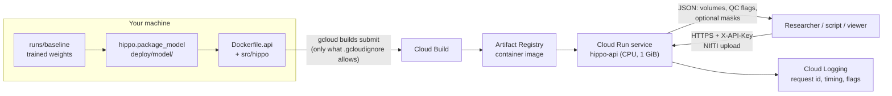
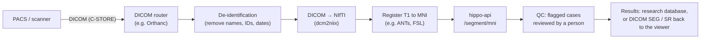

# Deployment: FastAPI service on Google Cloud Run

Research use only, not for diagnosis. Back to the [README](../README.md). The risks the service's checks
answer are in [intended use and risk](intended_use_and_risk.md).

The trained 3D U-Net is served as an HTTP API (FastAPI, `src/hippo/api.py`) in a Docker container on
**Google Cloud Run**, which runs containers on demand and scales to zero when idle, so a small research
service stays inside the free tier. The same image runs on any container host.

## Architecture



| Part | What it does | Why |
|---|---|---|
| Model package (`deploy/model/`) | The weights, their settings, and `metadata.json`: version (hash of the weights), MLflow run ids, preprocessing, training volume range, the MNI atlas boxes | The service never reads `runs/` or the training data; every response names the exact model version |
| FastAPI app (`hippo.api`) | Loads the model once at start-up; `/segment/crop` and `/segment/mni`; input checks and quality flags | One process, CPU only: a request takes well under a second |
| Container (`Dockerfile.api`) | CPU PyTorch, only the API's packages, non-root user | Small and reproducible; the same image locally and in the cloud |
| Cloud Build (`deploy/cloudbuild.yaml`) | Builds the image in the cloud | Gives the Linux/amd64 image Cloud Run needs, also from an Apple Silicon Mac |
| Artifact Registry | Stores the image | Cloud Run deploys from there |
| Cloud Run | Runs the container on demand behind HTTPS | Scales to zero (no cost while idle) and caps at one instance |
| Cloud Logging | One log line per request: id, input shape, time, flags | Monitoring without storing any image |

## What the API does

| Endpoint | Input | Output |
|---|---|---|
| `GET /health` | — | `{"status": "ok"}` once the model is loaded (no API key needed) |
| `GET /model` | — | Name, version, members, preprocessing, labels, cross-validation results, intended use |
| `POST /segment/crop` | One T1 crop around one hippocampus (NIfTI, 1 mm, ≤ 128 voxels per side) | Anterior, posterior and whole volume (ml), QC flags, optional mask |
| `POST /segment/mni` | Whole-brain T1 registered to MNI space (NIfTI, 1 mm) | Left and right, each as above; optional `largest=true` post-processing |

Every response carries the model name and version, a request id and the intended-use notice. Masks come
back as base64 gzipped NIfTI on the crop's grid with its affine, so they open in ITK-SNAP or 3D Slicer
over the scan.

**Checks taken from the risk table** (rows 5, 9 and 2):
- **Refused (HTTP 422):** not a 3D NIfTI, voxel size outside 0.8–1.25 mm, a crop larger than 128 voxels per side,
  or an "MNI" scan that doesn't contain the atlas boxes. Uploads over 30 MB are refused (413).
- **Flagged (`needs_review: true`):** more than one piece (islands), a part missing, the outline closer to the crop
  edge than any training label, and for crops a whole volume outside the training labels' range (2.38–4.40 ml).
- **Always warned for `/segment/mni`:** the API can't check that a scan is really in MNI space, and MNI volumes are
  scaled to the template brain.
- **Same voxels as the evaluation:** the MNI boxes are stored as world coordinates; on the MNI-HISUB25 scans they cut
  exactly the crops `hippo.external` evaluated, and the API reproduces the evaluation (s03: Dice 0.796 left,
  0.846 right, as in `runs/baseline/external/`).

## Run it locally

```bash
python -m hippo.package_model --experiment runs/baseline --src data/mri_dataset --single   # -> deploy/model/
PYTHONPATH=src uvicorn hippo.api:app --port 8000          # open http://127.0.0.1:8000/docs to try it
curl -F file=@data/Task04_Hippocampus/imagesTr/hippocampus_135.nii.gz http://127.0.0.1:8000/segment/crop
curl -F file=@data/mri_dataset/s03/s03_t1w_standard_defaced_MNI.nii.gz "http://127.0.0.1:8000/segment/mni?largest=true"
```

With Docker: `docker build -f Dockerfile.api -t hippo-api .` then `docker run -p 8080:8080 hippo-api`.
`--single` packages the single 3D U-Net run; without it, the 5 fold models are packaged and averaged.

## Deploy to Google Cloud Run

You run these; nothing here was run against a Google account. Replace `PROJECT_ID` (and the region if you
prefer another).

**1. Account and project (once).** Install the [gcloud CLI](https://cloud.google.com/sdk/docs/install), then:

```bash
gcloud init                                      # sign in, create or pick a project
gcloud config set project PROJECT_ID
gcloud config set run/region us-central1
```

A billing account is required even for the free tier (a card check, not a charge). In the console, under
**Billing → Budgets & alerts**, create a budget of a few dollars with email alerts, so any cost is visible at once.

**2. Turn on the services and create the image registry (once).**

```bash
gcloud services enable run.googleapis.com artifactregistry.googleapis.com cloudbuild.googleapis.com
gcloud artifacts repositories create hippo --repository-format=docker --location=us-central1
```

**3. Package the model and build the image in the cloud.**

```bash
python -m hippo.package_model --experiment runs/baseline --src data/mri_dataset --single
gcloud meta list-files-for-upload                # check: only Dockerfile.api, requirements-api.txt, src/, deploy/model/
VERSION=$(python -c "import json; print(json.load(open('deploy/model/metadata.json'))['version'])")
IMAGE=us-central1-docker.pkg.dev/PROJECT_ID/hippo/api:$VERSION
gcloud builds submit --config deploy/cloudbuild.yaml --substitutions _IMAGE=$IMAGE .
```

Tagging the image with the model version means each deployed image says which weights it holds.

**4. Deploy.**

```bash
gcloud run deploy hippo-api --image $IMAGE \
    --cpu 1 --memory 1Gi --concurrency 4 --timeout 60 \
    --min-instances 0 --max-instances 1 \
    --allow-unauthenticated --set-env-vars HIPPO_API_KEY=CHOOSE_A_LONG_RANDOM_KEY
```

- **`--min-instances 0`:** nothing runs (and nothing is billed) while idle. The first request after a pause waits for
  a cold start: Python, PyTorch and the model load (1.3 s locally) plus the container start.
- **`--max-instances 1`:** caps the cost; extra requests queue.
- **`--memory 1Gi`:** measured peak 562 MB with the model loaded and a whole-brain request running.
- **`--allow-unauthenticated` with an API key:** anyone can reach the URL, but only requests with the key get
  results. For a private service, drop `--allow-unauthenticated` and call it with Google identity tokens instead.
  Storing the key in Secret Manager (`--set-secrets`) is better than an environment variable for anything beyond a demo.

**5. Test it.** `gcloud run deploy` prints the service URL:

```bash
URL=$(gcloud run services describe hippo-api --format 'value(status.url)')
curl $URL/health
curl -H "X-API-Key: YOUR_KEY" -F file=@data/Task04_Hippocampus/imagesTr/hippocampus_135.nii.gz $URL/segment/crop
gcloud run services logs read hippo-api --limit 20     # one line per request
```

The interactive documentation is at `$URL/docs`. Use public research data only: never upload identifiable
patient scans to this demo.

**6. Update or remove.** Repackage, build with the new version tag and deploy again (Cloud Run keeps the old
revision for rollback). To remove everything:

```bash
gcloud run services delete hippo-api
gcloud artifacts repositories delete hippo --location=us-central1
```

## Cost

Google Cloud's free tier, checked on 2026-11-08 ([free features](https://docs.cloud.google.com/free/docs/free-cloud-features)):

| Service | Free per month | This service |
|---|---|---|
| Cloud Run (request-based billing) | 2 million requests, 180,000 vCPU-seconds, 360,000 GB-seconds, 1 GB outbound from North America | With request-based billing, time is counted while requests are handled: 180,000 vCPU-seconds is 50 hours of one CPU and 360,000 GB-seconds 100 hours at 1 GiB, against under a second per request |
| Artifact Registry | 0.5 GB storage | The CPU PyTorch image is probably larger, so storing it may cost a few cents a month; delete old images |
| Cloud Build | 2,500 build-minutes (e2-standard-2) | A build takes a few minutes |

Cloud Run accepts at most 32 MiB per HTTP/1 request ([quotas](https://docs.cloud.google.com/run/quotas)), so the
API's upload limit is 30 MB; a 1 mm whole-brain T1 is about 12 MB. Prices and free-tier terms change; check
them, and keep the budget alert.

## Monitoring and versions

- **Logs:** each request logs its id, input shape, time and flags (never the image). The share of requests with
  `needs_review` is a simple drift signal: if it rises, the inputs no longer look like the data the model was tested on.
- **Versions:** the model version is the hash of the weights, in every response, in the image tag and in
  `metadata.json`, with the MLflow run id of each model (`null` for the single run, which was trained before tracking;
  evaluating it once with `hippo.evaluate` gives it one).
- **Rollback:** each deploy is a Cloud Run revision; traffic can be sent back to the previous one.

## Towards real scans: integration design

The API takes NIfTI crops or MNI-registered brains. Scans from a hospital arrive as DICOM in native space, so
real use needs a pipeline in front of it. A design, not built:



- **De-identification first:** only de-identified images leave the hospital network; the cloud never sees names or IDs.
- **Registration** brings the scan into MNI space, which `/segment/mni` needs. Volumes are then in template space;
  reporting them in the subject's own space needs the inverse transform (or a native-space model).
- **Queue the work:** registration takes minutes, so a real pipeline would put jobs on a queue (e.g. Pub/Sub) and
  call the API from a worker, not from the scanner directly.
- **Human review:** flagged cases go to a person before any result is used.
- **Data protection and regulation:** patient data needs a legal basis (GDPR, HIPAA), a region that meets data-residency
  rules, access control and audit logs. Clinical use would make this a medical device (see
  [intended use and risk](intended_use_and_risk.md)): none of that is in place, so this deployment is for public
  research data only.
