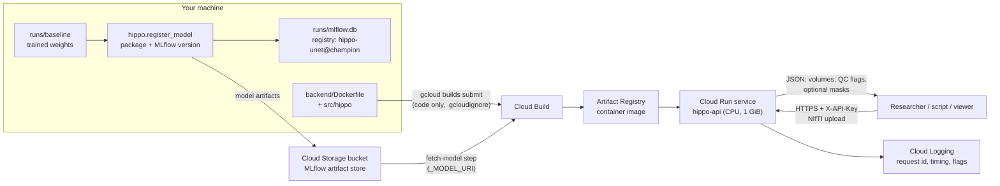
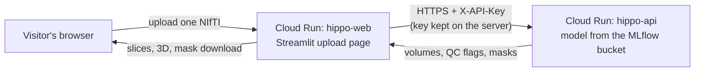
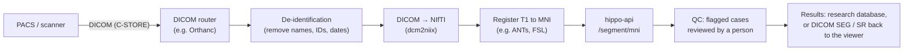

# Deployment: FastAPI service on Google Cloud Run

Research use only, not for diagnosis. Back to the [README](../README.md). The risks the service's checks
answer are in [intended use and risk](intended_use_and_risk.md).

The trained 3D U-Net is served as an HTTP API (FastAPI, `src/hippo/api.py`) in a Docker container on
**Google Cloud Run**, which runs containers on demand and scales to zero when idle, so a small research
service stays inside the free tier. The same image runs on any container host.

## Architecture



| Part | What it does | Why |
|---|---|---|
| Model package (`hippo.package_model`) | The weights, their settings, and `metadata.json`: version (hash of the weights), MLflow run ids, preprocessing, training volume range, the MNI atlas boxes | The service never reads `runs/` or the training data; every response names the exact model version |
| MLflow registry (`hippo.register_model`) | Logs each package as an MLflow run in the experiment `hippo-models` and registers it as a version of `hippo-unet`; an alias (`champion`) marks the one to deploy | Every deployed model is a registered version linked to its training runs; the registry stays in `runs/mlflow.db` on your machine (back it up) |
| Cloud Storage bucket | MLflow's artifact store for `hippo-models`: the packages themselves | The cloud reads the model from MLflow's store, not from your machine; no files are uploaded by hand |
| FastAPI app (`hippo.api`) | Loads the model once at start-up; `/segment/crop` and `/segment/mni`; input checks and quality flags | One process, CPU only: a request takes well under a second |
| Container (`backend/Dockerfile`) | CPU PyTorch, only the API's packages, non-root user | Small and reproducible; the same image locally and in the cloud |
| Cloud Build (`deploy/cloudbuild.yaml`) | Step 1 downloads the registered package from the bucket and checks its version; step 2 builds the image | Gives the Linux/amd64 image Cloud Run needs, also from an Apple Silicon Mac; the image tag always matches the weights inside |
| Artifact Registry | Stores the image | Cloud Run deploys from there |
| Cloud Run | Runs the container on demand behind HTTPS | Scales to zero (no cost while idle) and caps at one instance |
| Cloud Logging | One log line per request: id, input shape, time, flags | Monitoring without storing any image |

## What the API does

| Endpoint | Input | Output |
|---|---|---|
| `GET /health` | — | `{"status": "ok"}` once the model is loaded (no API key needed) |
| `GET /model` | — | Name, version, members, preprocessing, labels, cross-validation results, intended use |
| `POST /segment/crop` | One T1 crop around one hippocampus (NIfTI, 1 mm, ≤ 128 voxels per side) | Anterior, posterior and whole volume (ml), QC flags, optional mask |
| `POST /segment/mni` | Whole-brain T1 registered to MNI space (NIfTI, 1 mm) | Left and right, each as above; optional `largest=true` post-processing |

Every response carries the model name and version, a request id and the intended-use notice. Masks come
back as base64 gzipped NIfTI on the crop's grid with its affine, so they open in ITK-SNAP or 3D Slicer
over the scan.

**Checks taken from the risk table** (rows 5, 9 and 2):
- **Refused (HTTP 422):** not a 3D NIfTI, voxel size outside 0.8–1.25 mm, a crop larger than 128 voxels per side,
  or an "MNI" scan that doesn't contain the atlas boxes. Uploads over 30 MB are refused (413).
- **Flagged (`needs_review: true`):** more than one piece (islands), a part missing, the outline closer to the crop
  edge than any training label, and for crops a whole volume outside the training labels' range (2.38–4.40 ml).
- **Always warned for `/segment/mni`:** the API can't check that a scan is really in MNI space, and MNI volumes are
  scaled to the template brain.
- **Same voxels as the evaluation:** the MNI boxes are stored as world coordinates; on the MNI-HISUB25 scans they cut
  exactly the crops `hippo.external` evaluated, and the API reproduces the evaluation (s03: Dice 0.796 left,
  0.846 right, as in `runs/baseline/external/`).

## Run it locally

```bash
python -m hippo.package_model --experiment runs/baseline --src data/mri_dataset --single   # -> deploy/model/
PYTHONPATH=src uvicorn hippo.api:app --port 8000          # open http://127.0.0.1:8000/docs to try it
curl -F file=@data/Task04_Hippocampus/imagesTr/hippocampus_135.nii.gz http://127.0.0.1:8000/segment/crop
curl -F file=@data/mri_dataset/s03/s03_t1w_standard_defaced_MNI.nii.gz "http://127.0.0.1:8000/segment/mni?largest=true"
```

With Docker: `docker compose up --build backend` (key from `secrets/api_key.txt`, see [Docker](docker.md)), or
`docker build -f backend/Dockerfile -t hippo-api .` then `docker run -p 8080:8080 hippo-api`.
`--single` packages the single 3D U-Net run; without it, the 5 fold models are packaged and averaged.

## Deploy to Google Cloud Run

You run these. The model is registered in MLflow on your Mac and its artifacts go to a Cloud Storage
bucket; Cloud Build fetches it from there. Replace `PROJECT_ID` and `BUCKET` (a globally unique name, e.g.
`hippo-models-yourname`). `europe-west1` (Belgium) is in the EU and in Cloud Run's cheaper Tier 1.

**1. gcloud on your Mac, account and project (once).** Install the [gcloud CLI](https://cloud.google.com/sdk/docs/install)
(on macOS: `brew install --cask google-cloud-sdk`), then:

```bash
gcloud init                                      # sign in, create or pick a project
gcloud config set project PROJECT_ID
gcloud config set run/region europe-west1
gcloud auth application-default login            # credentials MLflow uses to write to the bucket
gcloud auth application-default set-quota-project PROJECT_ID
export GOOGLE_CLOUD_PROJECT=PROJECT_ID            # the Storage library does not read gcloud settings
echo 'export GOOGLE_CLOUD_PROJECT=PROJECT_ID' >> ~/.zshrc
```

There are two sign-ins: `gcloud auth login` (inside `gcloud init`) for gcloud commands, and
`gcloud auth application-default login` for Python libraries such as MLflow. In the macOS Terminal (zsh), run
`setopt interactive_comments` once (and add it to `~/.zshrc`), so the `#` comments below are ignored.

A billing account must be linked to the project even for the free tier (Billing → My projects → Change billing; a card
check, not a charge). Under **Billing → Budgets & alerts**, create a budget of a few euros with email alerts.

**2. Services, image registry, model bucket and build permissions (once).**

```bash
gcloud services enable run.googleapis.com artifactregistry.googleapis.com cloudbuild.googleapis.com storage.googleapis.com
gcloud artifacts repositories create hippo --repository-format=docker --location=europe-west1
gcloud storage buckets create gs://BUCKET --location=europe-west1 --uniform-bucket-level-access
gcloud storage buckets update gs://BUCKET --versioning      # an overwritten or deleted model can be recovered
# New projects: let the Cloud Build account read the upload and the bucket, push the image and write logs
PROJECT=$(gcloud config get-value project)
SA=$(gcloud projects describe $PROJECT --format='value(projectNumber)')-compute@developer.gserviceaccount.com
for ROLE in roles/cloudbuild.builds.builder roles/storage.objectViewer roles/artifactregistry.writer roles/logging.logWriter; do
  gcloud projects add-iam-policy-binding $PROJECT --member=serviceAccount:$SA --role=$ROLE
done
```

**3. Register the model in MLflow** (on your Mac; the first time with `--artifact-root`):

```bash
python -m hippo.register_model --experiment runs/baseline --src data/mri_dataset --single \
    --artifact-root gs://BUCKET/mlflow --alias champion
```

It prints the new version (e.g. `hippo-unet version 1 (weights aa4f93ffd511), alias 'champion'`) and the artifact
URI. Later models: the same command without `--artifact-root` (the experiment remembers its bucket). You can see the
versions in the MLflow page (**Models → hippo-unet**). `--single` registers the single 3D U-Net run; without it,
the 5 fold models are packaged and averaged.

**Which version is which, and which is in production.** MLflow names the bucket's run folders with random ids,
so every register or alias change also writes `REGISTRY.md` and `registry.json` to `gs://BUCKET/mlflow/`: one
row per version with its aliases, experiment, single run or ensemble, weights version and folder. New packages
also get a readable folder name, e.g. `.../artifacts/random_trim_5fold_a2d551dad98a`. **Production** is the
version with the alias `champion`, which step 4 builds.

```bash
python -m hippo.register_model --list                       # all versions; champion marked PRODUCTION
HIPPO_API_KEY=... python -m hippo.register_model --list --live https://SERVICE-URL   # + LIVE: what Cloud Run serves
python -m hippo.register_model --write-index                # rewrite the index in the bucket (e.g. for older versions)
```

`LIVE` and `PRODUCTION` on different rows means the alias was moved but the service wasn't rebuilt yet.

**4. Build the image from the champion.**

```bash
MODEL_URI=$(python -m hippo.register_model --show champion)
VERSION=$(python -m hippo.register_model --show champion --field weights_version)
IMAGE=europe-west1-docker.pkg.dev/$PROJECT/hippo/api:$VERSION
gcloud meta list-files-for-upload                # check: only backend/, requirements-api.txt, src/, deploy/cloudbuild.yaml
gcloud builds submit --config deploy/cloudbuild.yaml \
    --substitutions _MODEL_URI=$MODEL_URI,_VERSION=$VERSION,_IMAGE=$IMAGE .
```

The build's first step downloads the package from the bucket and stops if its version isn't `$VERSION`, so the image
tag always names the weights inside. No weights are uploaded from your Mac. (From Cloud Shell instead: run step 3 on
your Mac, then set `MODEL_URI` and `VERSION` by hand to the values it printed.)

**5. Deploy, with a real API key.**

```bash
KEY=$(openssl rand -hex 24); echo $KEY           # keep it somewhere private
gcloud run deploy hippo-api --image $IMAGE \
    --cpu 1 --memory 1Gi --concurrency 4 --timeout 60 \
    --min-instances 0 --max-instances 1 \
    --allow-unauthenticated --set-env-vars HIPPO_API_KEY=$KEY
```

- **`--min-instances 0`:** nothing runs (and nothing is billed) while idle. The first request after a pause waits for
  a cold start: Python, PyTorch and the model load (1.3 s locally) plus the container start.
- **`--max-instances 1`:** caps the cost; extra requests queue.
- **`--memory 1Gi`:** measured peak 562 MB with the model loaded and a whole-brain request running.
- **`--allow-unauthenticated` with an API key:** anyone can reach the URL, but only requests with the key get
  results. For a private service, drop `--allow-unauthenticated` and call it with Google identity tokens instead.
  Storing the key in Secret Manager (`--set-secrets`) is better than an environment variable for anything beyond a demo.
  To change the key: `gcloud run services update hippo-api --update-env-vars HIPPO_API_KEY=NEW_KEY`.

**6. Test it.**

```bash
URL=$(gcloud run services describe hippo-api --format 'value(status.url)')
curl $URL/health
curl -s -H "X-API-Key: $KEY" $URL/model | python3 -m json.tool | head -5      # version = $VERSION
curl -H "X-API-Key: $KEY" -F file=@data/Task04_Hippocampus/imagesTr/hippocampus_135.nii.gz $URL/segment/crop
gcloud run services logs read hippo-api --limit 20     # one line per request
```

The interactive documentation is at `$URL/docs`. Use public research data only: never upload identifiable
patient scans to this demo.

**7. A new model, rollback, or removal.**

- **New model:** retrain or repackage, run step 3 (with `--alias champion` to make it the one deployed), then steps 4–5.
- **Rollback:** point the alias back (`python -m hippo.register_model --promote 1 --alias champion`, or in the MLflow
  page) and rebuild; or send Cloud Run traffic back to the previous revision without rebuilding.
- **Remove everything:**

```bash
gcloud run services delete hippo-api
gcloud artifacts repositories delete hippo --location=europe-west1
gcloud storage rm --recursive gs://BUCKET      # the registered model artifacts
```

**Troubleshooting from the first deployment:** *"The required property [project] is not currently set"* → step 1's
`gcloud config set project`. *"active account [ACCOUNT]"* in Cloud Shell → `gcloud config set account YOUR_EMAIL`.
*"Billing account … not found"* → link billing (step 1). *"does not have storage.objects.get access"* during the build →
the permissions in step 2. *"missing or wrong X-API-Key"* → the key in your request isn't the one on the service
(`gcloud run services describe hippo-api --format='value(spec.template.spec.containers[0].env)'`).

## The model catalogue in the bucket

MLflow stores each package under a random run id. Next to those folders, `hippo.register_model` keeps a readable
catalogue, which the cloud builds read:

```
gs://BUCKET/models/hippo-unet/
  README.md                       every model: registry versions, aliases, PRODUCTION, experiment, kind, weights, date
  catalog.json                    the same for scripts
  aliases/champion.json           which version and folder each alias points to (champion = production)
  baseline_single_aa4f93ffd511/   MODEL_CARD.md, metadata.json, config.yaml, best.pt
  random_trim_5fold_a2d551dad98a/ MODEL_CARD.md, metadata.json, fold0/ ... fold4/
```

- **Model card** (`MODEL_CARD.md`): what the model is, where it came from (experiment, folds, training MLflow run ids),
  preprocessing, the training volume range, the cross-validation results it carries, and the intended use.
- **Metadata on every file** (Cloud Storage custom metadata, under the object's details in the console):
  `model`, `registry-versions`, `aliases`, `production`, `experiment`, `kind`, `weights-version`, `registered`,
  `members`, `combination`, `intended-use`. From the terminal: `gcloud storage objects describe gs://BUCKET/models/hippo-unet/<folder>/best.pt`.
- **Kept up to date** by `register` and `--promote`. Versions with the same weights share one folder; weights already
  there aren't uploaded again. Each registry version is tagged `catalog_uri`, and `--show` and `--build-list` return
  it (`--show ALIAS --field source` gives MLflow's own copy).
- **First time, or after changing aliases in the MLflow page:** `python -m hippo.register_model --publish-catalog`.

## Several models in one service

One API image can hold several registered versions, to try them side by side. List MLflow aliases; the first is
the default, and the others are served as `?model=<alias>`:

```bash
MODELS=$(python -m hippo.register_model --build-list champion random_trim ensemble)
echo "$MODELS"                                   # champion=gs://…=aa4f93ffd511;random_trim=…;ensemble=…
IMAGE=europe-west1-docker.pkg.dev/$PROJECT/hippo/api:multi-$(date +%Y%m%d-%H%M)
gcloud builds submit --config deploy/cloudbuild-models.yaml --substitutions "_MODELS=$MODELS,_IMAGE=$IMAGE" .
gcloud run deploy hippo-api --image $IMAGE --region europe-west1
```

- **What the build does** (`deploy/cloudbuild-models.yaml`): downloads each version from the bucket into
  `deploy/model/versions/<alias>/`, copies the first to `deploy/model/` as the default, checks every weights
  version, then builds as usual. `deploy/cloudbuild.yaml` (one model) is unchanged.
- **Using it:** `GET /models` lists them (alias, name, weights version, single or ensemble, which is the default);
  add `?model=ensemble` to `/segment/crop`, `/segment/mni` or `/model`. Without it, the default answers. An unknown
  name gets 404 with the list. Every response names the model in `model.key`.
- **The upload page** shows a **Models** box from `GET /models` (refreshed every 10 minutes). Pick several to compare them on one scan: a table of volumes, pieces, flags and Dice agreement with the first model picked (agreement, not accuracy: there is no ground truth), one row of slices per model with shared sliders, 3D views and a mask download each.
- **Memory:** three models (champion, random_trim, the 5-fold ensemble: 7 networks) peaked at 631 MB in the API's
  environment, against about 562 MB for one, so `--memory 1Gi` is still enough.
- **Default:** set `HIPPO_DEFAULT_MODEL=<alias>` on the service to change it without rebuilding.

## The upload page (Streamlit on Cloud Run)

A second Cloud Run service, `hippo-web`, serves `streamlit_dashboard/upload_page.py`: a visitor uploads one T1
scan (a hippocampus crop, or a whole brain in MNI space), clicks **Segment**, and sees the volumes, quality flags,
the three slice views, an optional 3D view, and a download of the mask. The page doesn't run the model: it calls
`hippo-api` (model from the MLflow bucket) with the API key, which stays on the server. Its image (`webapp/Dockerfile`)
has no PyTorch. The local research page (`compare_slices.py`, `frontend/`) is separate and unchanged.



**Build and deploy** (after `hippo-api` is running; from the project root):

```bash
PROJECT=$(gcloud config get-value project)
TAG=$(date +%Y%m%d-%H%M)
WEBIMAGE=europe-west1-docker.pkg.dev/$PROJECT/hippo/webapp:$TAG
gcloud builds submit --config deploy/cloudbuild-webapp.yaml --substitutions _IMAGE=$WEBIMAGE .
API_URL=$(gcloud run services describe hippo-api --region europe-west1 --format 'value(status.url)')
KEY=$(gcloud run services describe hippo-api --region europe-west1 --format='value(spec.template.spec.containers[0].env[0].value)')
gcloud run deploy hippo-web --image $WEBIMAGE --region europe-west1 \
    --cpu 1 --memory 1Gi --min-instances 0 --max-instances 1 \
    --timeout 3600 --session-affinity --allow-unauthenticated \
    --set-env-vars HIPPO_API_URL=$API_URL,HIPPO_API_KEY=$KEY
gcloud run services describe hippo-web --region europe-west1 --format 'value(status.url)'   # open this
```

- **`--timeout 3600` and `--session-affinity`:** Streamlit keeps one live connection per visitor; a short timeout
  would cut it, and affinity keeps a visitor on the same instance.
- **Cost:** with request-based billing, the instance counts as busy while a visitor has the page open (up to the
  60-minute timeout), so each open tab uses the free allowance (about 50 CPU-hours a month). `--max-instances 1`
  caps it; the budget alert catches anything more.
- **Who can use it:** the page is public, so anyone with its address can upload a scan and use the API through it,
  without seeing the key. Share the address only with people you want to test it. For named users only, add
  Google sign-in (Streamlit `st.login`) or put the page behind Identity-Aware Proxy (not set up here).
- **After changing the API key:** redeploy `hippo-web` with the new `HIPPO_API_KEY`, or the page's requests are refused.
- **Data:** the page stores nothing, but uploads travel over the internet: public research scans only, never
  identifiable patient data (the page says so).

### Example scans (for visitors without a file)

The sidebar's **Example scan** box offers four crops with their manual labels (`hippo.examples`), and the page
scores each model against the label (Dice). They live in the bucket, so they can change without a rebuild:

| Example | Data | Why | 3D U-Net Dice (champion) |
|---|---|---|---|
| `msd_008` | MSD test case | in distribution, held out | anterior 0.894, posterior 0.917, whole 0.916 |
| `msd_007` | MSD validation case | probably the other side of 008 (MSD records no side) | anterior 0.910, posterior 0.890, whole 0.922 |
| `s03_L` | MNI-HISUB25, left | external, side known | whole 0.796 (subfield labels: whole only) |
| `s03_R` | MNI-HISUB25, right | the same person's right side | whole 0.846 |

No MSD test case has its possible partner in test, so the pair is one test and one validation case; neither was
trained on. Licences, shown next to each example: MSD CC BY-SA 4.0; MNI-HISUB25 CC BY-NC-SA 3.0 (non-commercial,
with attribution). The Dice values were checked locally with the champion package through the API code.

```bash
python -m hippo.examples --out deploy/examples                       # 4 crops + labels + examples.json (~0.9 MB)
gcloud storage cp --recursive deploy/examples/* gs://BUCKET/examples/
# Let hippo-web's service account read the bucket (the default compute account unless you set another)
SA=$(gcloud run services describe hippo-web --region europe-west1 --format 'value(spec.template.spec.serviceAccountName)')
SA=${SA:-$(gcloud projects describe $PROJECT --format 'value(projectNumber)')-compute@developer.gserviceaccount.com}
gcloud storage buckets add-iam-policy-binding gs://BUCKET --member serviceAccount:$SA --role roles/storage.objectViewer
# Rebuild hippo-web (the page now reads the bucket) and point it at the examples
gcloud builds submit --config deploy/cloudbuild-webapp.yaml --substitutions _IMAGE=$WEBIMAGE .
gcloud run deploy hippo-web --image $WEBIMAGE --region europe-west1 --update-env-vars HIPPO_EXAMPLES_URI=gs://BUCKET/examples
```

The bucket stays private: the page reads the examples with its own service account, and visitors only see them
through the page. Without `HIPPO_EXAMPLES_URI` the page works as before (uploads only).

## Cost

Google Cloud's free tier, checked on 2026-11-08 ([free features](https://docs.cloud.google.com/free/docs/free-cloud-features)):

| Service | Free per month | This service |
|---|---|---|
| Cloud Run (request-based billing) | 2 million requests, 180,000 vCPU-seconds, 360,000 GB-seconds, 1 GB outbound from North America | With request-based billing, time is counted while requests are handled: 180,000 vCPU-seconds is 50 hours of one CPU and 360,000 GB-seconds 100 hours at 1 GiB, against under a second per request |
| Artifact Registry | 0.5 GB storage | The CPU PyTorch image is probably larger, so storing it may cost a few cents a month; delete old images |
| Cloud Build | 2,500 build-minutes (e2-standard-2) | A build takes a few minutes |
| Cloud Storage (model bucket) | 5 GB, but only in US regions | One package is about 5 MB; in europe-west1 at about $0.022 per GB-month that is a fraction of a cent (not checked on Google's English price page) |

Cloud Run accepts at most 32 MiB per HTTP/1 request ([quotas](https://docs.cloud.google.com/run/quotas)), so the
API's upload limit is 30 MB; a 1 mm whole-brain T1 is about 12 MB. Prices and free-tier terms change; check
them, and keep the budget alert.

## Monitoring and versions

- **Logs:** each request logs its id, input shape, time and flags (never the image). The share of requests with
  `needs_review` is a simple drift signal: if it rises, the inputs no longer look like the data the model was tested on.
- **Versions:** the model version is the hash of the weights, in every response, in the image tag and in
  `metadata.json`, with the MLflow run id of each model (`null` for the single run, which was trained before tracking;
  evaluating it once with `hippo.evaluate` gives it one).
- **Rollback:** each deploy is a Cloud Run revision; traffic can be sent back to the previous one.

## Towards real scans: integration design

The API takes NIfTI crops or MNI-registered brains. Scans from a hospital arrive as DICOM in native space, so
real use needs a pipeline in front of it. A design, not built:



- **De-identification first:** only de-identified images leave the hospital network; the cloud never sees names or IDs.
- **Registration** brings the scan into MNI space, which `/segment/mni` needs. Volumes are then in template space;
  reporting them in the subject's own space needs the inverse transform (or a native-space model).
- **Queue the work:** registration takes minutes, so a real pipeline would put jobs on a queue (e.g. Pub/Sub) and
  call the API from a worker, not from the scanner directly.
- **Human review:** flagged cases go to a person before any result is used.
- **Data protection and regulation:** patient data needs a legal basis (GDPR, HIPAA), a region that meets data-residency
  rules, access control and audit logs. Clinical use would make this a medical device (see
  [intended use and risk](intended_use_and_risk.md)): none of that is in place, so this deployment is for public
  research data only.
