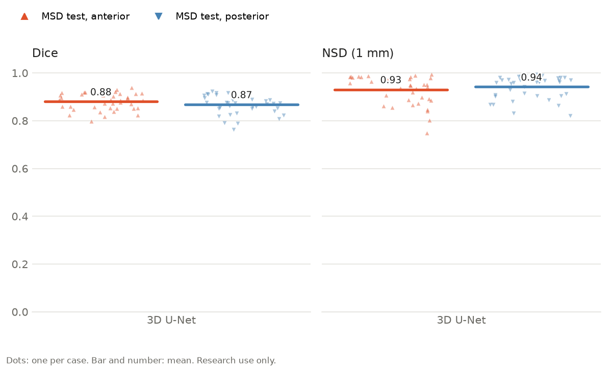
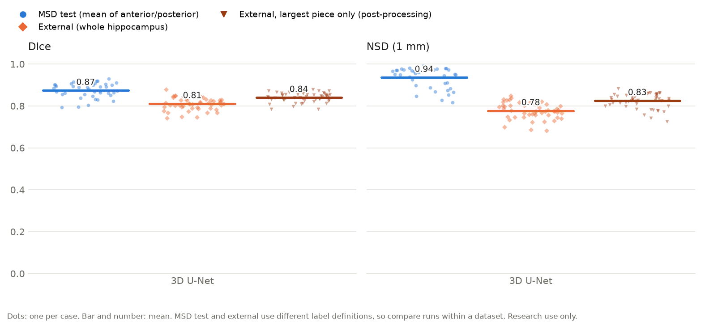
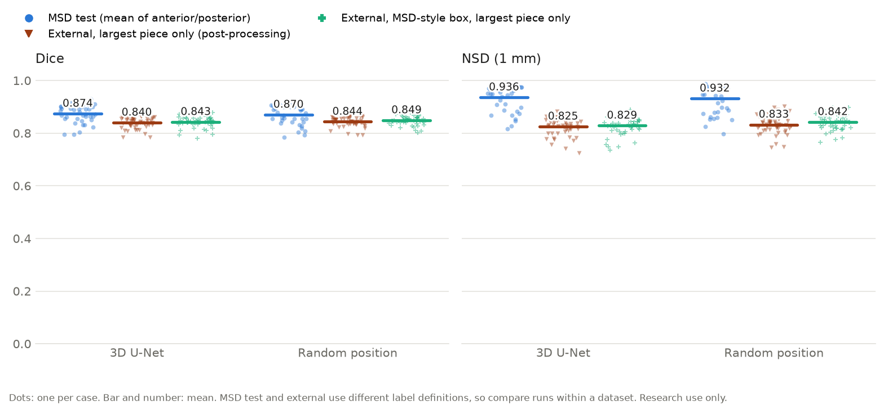
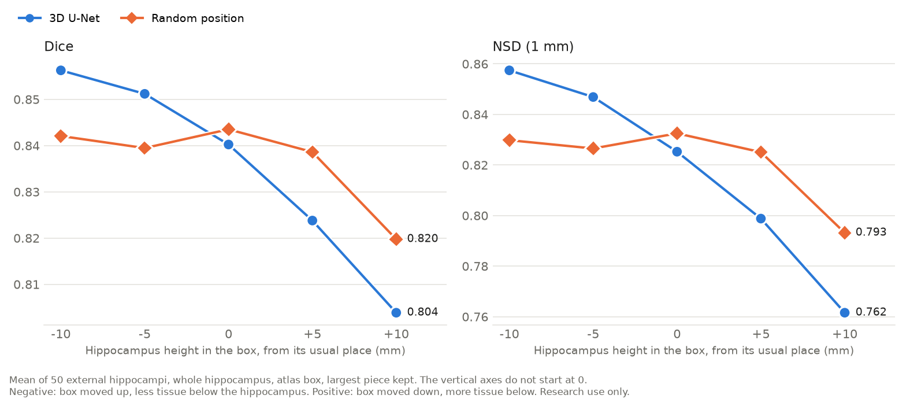

# Results, experiments and error analysis

Research use only, not for diagnosis. Back to the [README](../README.md). How the numbers are made: [methods](methods.md).

## Main results: single 3D U-Net run

> **The 3D U-Net performs best on in-distribution data.** On the MSD test split (39 unseen cases from the same source as the training data), whole-hippocampus Dice is **0.897** and NSD **0.959** (anterior 0.880 / 0.931, posterior 0.868 / 0.942). On the external MNI-HISUB25 data it drops to **0.811 / 0.777** (0.840 / 0.825 after keeping the largest piece). Part of that drop comes from the two datasets labelling the hippocampus differently, not only from model error (see [Limitations](limitations.md)).

**In distribution (MSD test, 39 cases), per part:**

The two parts score about the same: anterior Dice 0.880 / NSD 0.931, posterior 0.868 / 0.942.

**In distribution vs external:**

| Test set | Scored as | Dice | NSD (1 mm) | Cases |
|---|---|---|---|---|
| MSD test (in distribution) | anterior | 0.880 ± 0.035 | 0.931 ± 0.059 | 39 |
| MSD test (in distribution) | posterior | 0.868 ± 0.039 | 0.942 ± 0.047 | 39 |
| MSD test (in distribution) | mean of anterior and posterior | 0.874 | 0.936 | 39 |
| MSD test (in distribution) | whole hippocampus | 0.897 | 0.959 | 39 |
| MNI-HISUB25 (external) | whole hippocampus | **0.811 ± 0.030** | **0.777 ± 0.038** | 50 (25 subjects × left/right) |
| MNI-HISUB25 (external), largest connected piece only | whole hippocampus | 0.840 ± 0.022 | 0.825 ± 0.034 | 50 |

- **Which rows to compare:** the external labels can only be scored as the whole hippocampus, so the fair comparison is the MSD "whole hippocampus" row against the external rows. The figure shows MSD the way it is usually reported (mean of the two parts).
- **Left vs right:** external Dice is 0.807 on the left and 0.815 on the right (no difference, p = 0.49).
- **Figures:** each dot is one case and the bar is the mean. The dark orange triangles are the external hippocampi after keeping the largest piece.
- **Main result has no shift or post-processing.** Largest-piece post-processing is applied to the **external dataset only**; all MSD rows use the plain prediction. Keeping the largest piece removes stray islands and improves all 50 external hippocampi (Dice 0.811 → 0.840, NSD 0.777 → 0.825), but that step was chosen after looking at the external errors, so it is a secondary result.

## Cross-validation (pending)

Five fold models per experiment, each scored on the fixed MSD test split and the external data, with Dice, HD95, NSD, absolute and relative volume error and ICC per label, and a Bland–Altman plot. Made by `scripts/run_cv.sh` and `python -m hippo.results`; not trained yet. The tables will go here.

## Experiments

One change per experiment, everything else as in the 3D U-Net. MSD test Dice is the mean of anterior and posterior; external Dice is the whole hippocampus.

| Experiment | Question | Change | Result | Decision |
|---|---|---|---|---|
| Clean labels | Do small stray label pieces hurt training? | Train on labels with small stray pieces removed (`configs/clean_labels.yaml`; 4 voxels in 1 case changed) | MSD 0.874 → 0.875 (all p > 0.5); external 0.811 → 0.813 (p = 0.31) | No effect; keep the raw labels |
| No normalisation | Is per-scan z-scoring needed? | Raw intensities (`configs/no_norm.yaml`) | MSD 0.874 → 0.774 (p < 0.001); external 0.811 → 0.740 | Keep z-scoring |
| Zero border | Does the model depend on its surroundings? | A 10-voxel zero border around the MSD test crops | 0.874 → 0.833 (35 of 39 worse, p < 0.001) | Crops must look like the training crops |
| Box position | Does external crop placement matter? | Atlas box moved ±5 / ±10 mm per axis | Down to −0.086 Dice (hippocampus 10 mm higher in the box: all 50 worse) | Not tuned (that would use the test labels); led to the MSD-style box |
| Largest piece | Are stray islands a main error? | Keep each prediction's largest connected piece (external only) | External 0.811 → 0.840, all 50 better | Opt-in, secondary: chosen after seeing the errors |
| MSD-style box | Does cropping like MSD help, without labels? | Box = first prediction's bounding box + MSD's median margins | External 0.843 with largest piece; 35 of 50 already one piece | Diagnostic; the fixed rule in the random position experiment |
| Shifted predictions | Can the prediction's offset be corrected? | Shift each mask by the offset learned on other subjects | 0.840 → 0.794 on held-out subjects (47 of 50 worse) | Rejected: the offset is a shape difference, not a position error |
| ASHS check | Are the external labels right? | Independent tool (ASHS-PMC-T1) on s03 and s17 | ASHS centre within 0.8 mm of the labels; the model 1.8–3.3 mm off | The gap comes from MSD's labels, not the external ones |
| Random position | Does varying the position in training help? | Random 5-voxel sub-crop in z (`configs/random_trim.yaml`) | Position range 0.052 → 0.024; islands 0.33 → 0.11 ml; external 0.849 vs 0.843 (MSD-style box); MSD 0.870 vs 0.874 (p = 0.03) | Failed one pre-set criterion; the 3D U-Net stays the main model |

Single training runs (one seed); the external data guided several of these decisions, so the external numbers are not an independent test.

### Random position experiment in detail

External Dice depends on where the crop box sits around the hippocampus, because MSD crops always centre it. So a second model was trained with one change: each training crop loses 5 voxels in z, split at random between top and bottom, so the hippocampus lands in a different place each time. All voxels stay real tissue and the label is never cut. MSD crops leave about 5 mm of tissue above and below the hippocampus, which is enough room, but it only moves the hippocampus about ±2.5 mm from the window centre. The success criteria were written down before training ([plan and full results](retraining_plan.md)).

| Test set | Scored as | 3D U-Net (Dice / NSD) | Random position (Dice / NSD) | Dice change: better / worse cases, p |
|---|---|---|---|---|
| MSD test | mean of anterior and posterior | 0.874 / 0.936 | 0.870 / 0.932 | 13 / 26, p = 0.03 |
| MNI-HISUB25, MSD-style box, largest piece | whole hippocampus | 0.843 / 0.829 | 0.849 / 0.842 | 35 / 15, p = 0.003 |
| MNI-HISUB25, atlas box, largest piece | whole hippocampus | 0.840 / 0.825 | 0.844 / 0.833 | 29 / 21, p = 0.34 |

*Each mark is one case and the bar is the mean. The external "largest piece only" group uses the atlas box. MSD test and external use different label definitions, so compare the two models within a group.*

**Moving the atlas box up or down** (50 external hippocampi, largest piece):

*The vertical axes do not start at 0, so small differences look larger than in the figure above. Negative: the box moved up, leaving less tissue below the hippocampus. Positive: the box moved down, leaving more tissue below.*

| Hippocampus height in the box (Dice) | −10 mm | −5 mm | 0 | +5 mm | +10 mm | Range |
|---|---|---|---|---|---|---|
| 3D U-Net | 0.856 | 0.851 | 0.840 | 0.824 | 0.804 | 0.052 |
| Random position | 0.842 | 0.840 | 0.844 | 0.839 | 0.820 | 0.024 |

- **Position sensitivity:** the range across box positions halves, but the average barely moves (0.835 → 0.837). The new model is better when the box sits too low (hippocampus +5 and +10 mm, p < 0.001) and worse where the 3D U-Net already did well (−5 and −10 mm, p < 0.001). That lower best point (0.844 vs 0.856) is the criterion it failed: the limit was a drop of 0.01, and the drop was 0.013.
- **Islands:** volume removed by keeping the largest piece drops from 0.333 to 0.109 ml on the atlas box (lower in 40 of 50, p < 0.001).
- **Missing tissue remains:** on the MSD-style box the model still misses 15.8% of the external hippocampus (17.5% before). Moving the hippocampus during training cannot teach tissue that the MSD labels leave out.

**Where the errors changed** (plain atlas box, before keeping the largest piece; mean per external hippocampus, paired over 50 cases):

| Error | 3D U-Net | Random position | Lower / higher in | p |
|---|---:|---:|---:|---:|
| Extra voxels, total | 1.12 ml | 0.91 ml | 38 / 12 | < 0.001 |
| Extra: islands (separate pieces) | 0.33 ml | 0.11 ml | 40 / 9 | < 0.001 |
| Extra: within 1 mm of the label | 0.55 ml | 0.64 ml | 0 / 50 | < 0.001 |
| Missed voxels, total | 0.71 ml | 0.66 ml | 34 / 16 | 0.001 |
| Missed: within 1 mm of the prediction | 0.40 ml | 0.36 ml | 45 / 5 | < 0.001 |
| Missed: chunks more than 1 mm away | 0.31 ml | 0.31 ml | 21 / 29 | 0.93 |

- **Islands:** the new model removes most of the islands below the hippocampus, the error linked to cropping.
- **Missed chunks:** they don't change at all. Most missed voxels are on the inner side (median 86% per hippocampus) and in the subiculum, the tissue MSD's labels leave out.
- **The missed voxels it does recover lie at the edge:** its outline sits slightly wider, which also adds extra voxels at the edge in all 50 hippocampi and further into the tail (0.16 → 0.28 ml).

So the remaining external gap comes from what the training labels contain, not from where the crop is cut.

## Error analysis of the 3D U-Net

The worst 10 cases per test set (lowest whole-hippocampus Dice, plain prediction), with each case's wrong voxels split into groups and the case put in the bucket with the most (`python -m hippo.errors --run runs/baseline`; a case with Dice below 0.5 would be a complete failure).

| Bucket | MNI-HISUB25, worst 10 | MSD test, worst 10 |
|---|---:|---:|
| Over-segmentation of the main piece (outline too wide) | 6 | 7 |
| False-positive islands | 2 | 0 |
| Under-segmentation (at the boundary or as missed chunks) | 2 | 3 |
| Anterior/posterior split | 0 (not measurable: no parts in the labels) | 0 |
| Complete failure (domain shift) | 0 | 0 |

Share of all wrong voxels in those cases:

| Error type | MNI-HISUB25 | MSD test |
|---|---:|---:|
| Over-segmentation of the main piece | 40% | 51% |
| Islands | 27% | 0% |
| Missed at the boundary | 18% | 34% |
| Missed as whole chunks | 15% | 9% |
| Anterior/posterior split | — | 6% |

- **The boundary matters most:** the outline is too wide or stops short; islands come second on external data, and no case fails completely (worst external Dice 0.742, s16_L).
- **Over-segmentation** is a fifth bucket, added so that no error is hidden. On external data part of it may be a labelling difference (the model's front edge reaches about 4 mm past the external label).
- **The split** can only be measured on MSD, where it is 6% of the error and never the main bucket.
