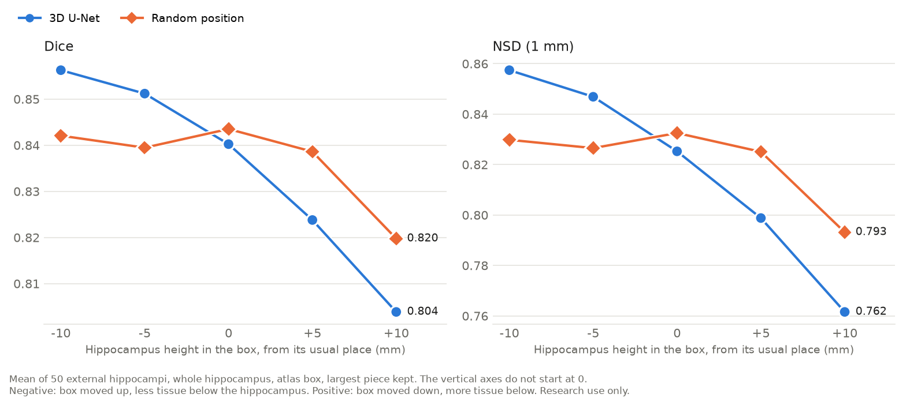
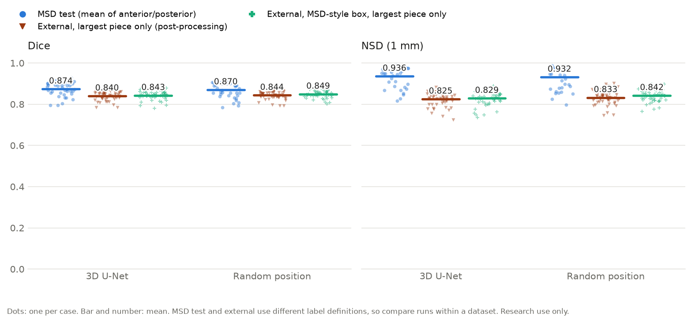

# Retraining plan: random sub-cropping

Steps 0–5 were written 2026-11-06, before training, so the criteria can't be fitted to the result; the results were added afterwards. Research use only, not for diagnosis.

**Question.** Does the 3D U-Net depend less on where the hippocampus sits in the box if it is trained with the hippocampus in varying positions?

## Step 0: is there room? Yes

Distance from the label to the crop edge, 182 MSD training cases, mm:

| Side | Min | 5th pct | Median | Max | At least 4 mm |
|---|---:|---:|---:|---:|---:|
| Down (z low) | 3 | 4 | 5 | 9 | 97.3% |
| Up (z high) | 3 | 4 | 5 | 8 | 99.5% |
| Back (y low) | 3 | 4 | 5 | 8 | 98.9% |
| Front (y high) | 3 | 4 | 6 | 10 | 99.5% |
| Left (x low) | 4 | 4 | 6 | 12 | 100% |
| Right (x high) | 4 | 5 | 7 | 12 | 100% |

The tighter of the two vertical sides is at least 4 mm in 96.7% of cases and at least 3 mm in all of them. The margins are real tissue: at most 0.1% of their voxels are exactly zero. The rule was "at least about 3–4 mm vertically: retrain", so this passes.

## Steps 1–2: the one change

`configs/random_trim.yaml` is the baseline config with `random_trim: [0, 0, 5]` and its own `out_dir`. Each training crop loses 5 voxels in z, split at random between top and bottom. The cut never enters the label. Validation and test always use whole crops. Architecture, epochs, loss, learning rate, seed and split are unchanged. The seed value is the same, but the extra random step changes the random draws that follow it.

**What this covers.** Run on the real training crops (182 cases, 20 draws each): no label voxels lost, and the hippocampus's centre lands within about ±2.5 mm of the window centre (5th to 95th percentile). The range is half the trim, because moving the centre by 1 mm needs 2 mm of difference between the two sides. This covers the 2.5–3 mm misplacement of the atlas box, but not the ±5 and ±10 mm points on the curve.

## Step 3: inference rule, fixed in advance

MSD-style box (first prediction's bounding box plus the median MSD margins, `hippo.external --msd-crop`) and largest piece kept, for both models. The 3D U-Net scores Dice 0.843 / NSD 0.829 on it (50 external hippocampi).

## Step 4: success criteria

The thresholds in the table were proposed before training and were not changed afterwards.

| Check | Measured on | 3D U-Net now | Success |
|---|---|---|---|
| MSD internal test | 39 test cases, mean of anterior and posterior Dice | 0.874 | Dice at least 0.864 |
| Robustness curve | 50 external hippocampi, atlas box moved in z, largest piece | see below; range 0.052 | Range at most 0.037, **and** Dice at z+10 higher with paired Wilcoxon p < 0.05, **and** best point no more than 0.01 lower |
| Islands | 50 external hippocampi, plain atlas box, `removed_ml` before the largest piece is kept | mean 0.333 ml, 4.0 pieces | Lower `removed_ml`, paired Wilcoxon p < 0.05 |
| MICCAI (untouched) | Not in the project yet | Not run | Run once at the end with the winning model; report as-is |

Baseline curve, whole-hippocampus Dice with largest piece. Heights are named as in `archive/shift.py`: z+10 means the hippocampus sits 10 mm higher in the box, because the box moved 10 mm down:

| Hippocampus height in the box (mm) | -10 | -5 | 0 | +5 | +10 |
|---|---:|---:|---:|---:|---:|
| Dice | 0.856 | 0.851 | 0.840 | 0.824 | 0.804 |

**Why these thresholds.**
- **Noise between runs:** the clean_labels run is nearly the same training (cleaning changed 4 voxels in 1 case), so it shows the difference between two runs. Its curve range is 0.051 against 0.052, and no point differs by more than 0.004. A drop of 0.015 is well above that.
- **The extra conditions on the curve:** a model that got worse everywhere could also look flatter. Requiring z+10 to rise and the best point to hold rules that out.
- **Coverage at z+10:** this box cuts off part of some hippocampi (lowest coverage 0.918), the same for both models, which limits the best Dice possible there.
- **Islands on the atlas box:** the MSD-style box leaves almost nothing to measure (mean 0.023 ml, 35 of 50 already one piece). `removed_ml` counts all islands, not only those below the hippocampus.

## Step 5: decide and stop

- Better on the curve without losing on MSD: the new model becomes the main model.
- Not better: keep the current 3D U-Net and report the experiment as it came out.

The external data has now guided several decisions, so these results are not an independent test. That is why the MICCAI data stays untouched until the end.

## Results

**Outcome: the 3D U-Net stays the main model.** The new model met every criterion measured except one: its best point on the curve fell by 0.013, against a limit of 0.01. MICCAI has not been run.

| Check | Needed | 3D U-Net | Random trim | Status |
|---|---|---:|---:|---|
| MSD test Dice | At least 0.864 | 0.874 | 0.870 | Pass |
| Curve range | At most 0.037 | 0.052 | 0.024 | Pass |
| Dice at z+10 | Higher, p < 0.05 | 0.804 | 0.820 (p < 0.001) | Pass |
| Curve best point | At least 0.846 | 0.856 | 0.844 | **Fail** |
| Islands, `removed_ml` | Lower, p < 0.05 | 0.333 ml | 0.109 ml (p < 0.001) | Pass |

The MSD test drop is small but looks real: 26 of 39 cases got worse (p = 0.03).



**Curve** (whole-hippocampus Dice, 50 external hippocampi, atlas box, largest piece):

| Hippocampus height in the box (mm) | -10 | -5 | 0 | +5 | +10 | Mean |
|---|---:|---:|---:|---:|---:|---:|
| 3D U-Net | 0.856 | 0.851 | 0.840 | 0.824 | 0.804 | 0.835 |
| Random trim | 0.842 | 0.840 | 0.844 | 0.839 | 0.820 | 0.837 |
| Better / worse cases | 1 / 49 | 7 / 43 | 29 / 21 | 37 / 13 | 35 / 15 | |
| p | < 0.001 | < 0.001 | 0.34 | < 0.001 | < 0.001 | |



**Fixed inference rule** (MSD-style box, largest piece, Step 3):

| Measure | 3D U-Net | Random trim | Paired p |
|---|---:|---:|---:|
| Dice | 0.843 | 0.849 | 0.003 |
| NSD | 0.829 | 0.842 | < 0.001 |
| Missed volume | 0.81 ml (17.5% of true volume) | 0.73 ml (15.8%) | < 0.001 |
| Extra volume | 0.62 ml | 0.65 ml | 0.003 |
| Predicted volume (true 4.62 ml) | 4.43 ml | 4.55 ml | not tested |

Missed and extra volumes are worked out from each case's Dice and volumes. The fall in missed volume goes with a larger prediction overall.

**Where the errors are** (plain atlas box, before keeping the largest piece; mean per hippocampus over 50 external hippocampi; paired Wilcoxon). Extra voxels:

| Group | 3D U-Net | Random trim | Change | Lower / higher in | p |
|---|---:|---:|---:|---:|---:|
| Total | 1.119 ml | 0.910 ml | −19% | 38 / 12 | < 0.001 |
| Islands | 0.333 ml | 0.109 ml | −67% | 40 / 9 | < 0.001 |
| Main piece | 0.786 ml | 0.801 ml | +2% | 15 / 35 | 0.04 |
| Below the label's centre | 0.841 ml | 0.595 ml | −29% | 39 / 11 | < 0.001 |
| Above the label's centre | 0.277 ml | 0.316 ml | +14% | 9 / 40 | < 0.001 |
| Within 1 mm of the label | 0.546 ml | 0.642 ml | +18% | 0 / 50 | < 0.001 |
| More than 1 mm away | 0.573 ml | 0.268 ml | −53% | 44 / 6 | < 0.001 |
| Tail | 0.156 ml | 0.276 ml | +78% | 1 / 49 | < 0.001 |
| In front of the label | 0.151 ml | 0.057 ml | −63% | 45 / 5 | < 0.001 |

Missed voxels:

| Group | 3D U-Net | Random trim | Change | Lower / higher in | p |
|---|---:|---:|---:|---:|---:|
| Total | 0.706 ml | 0.664 ml | −6% | 34 / 16 | 0.001 |
| Within 1 mm of the prediction | 0.400 ml | 0.357 ml | −11% | 45 / 5 | < 0.001 |
| More than 1 mm away | 0.306 ml | 0.307 ml | 0% | 21 / 29 | 0.93 |
| Inner side, more than 1 mm away | 0.296 ml | 0.296 ml | 0% | 23 / 27 | 0.98 |
| Subiculum | 0.190 ml | 0.181 ml | −5% | 33 / 17 | 0.03 |

- **What fell:** islands and other extra voxels away from the label, mostly below it.
- **Where the recovered missed voxels are:** at the edge. The outline sits slightly wider, which also adds extra voxels at the edge and in the tail.
- **What didn't change:** the missed chunks on the inner side, the tissue MSD's labels leave out. 86% of missed voxels are still on the inner side (median per hippocampus; 50 of 50 more than half inner).

**What was not tested:** a second training seed, and the fixed inference rule across seeds. clean_labels has no MSD-style box result, so there is no run-to-run comparison for that row.

## Reproduce

```bash
export PYTHONPATH=src
python -m hippo.train --config configs/random_trim.yaml
python -m hippo.evaluate --run runs/random_trim
python -m hippo.compare runs/baseline runs/random_trim
python -m hippo.external --src data/mri_dataset --run runs/random_trim --largest-piece
python -m hippo.external --src data/mri_dataset --run runs/random_trim --msd-crop --largest-piece --out data/external_msd_crop_random_trim
python archive/shift.py --external data/mri_dataset --run runs/random_trim --axes z --largest-piece
python archive/external_analysis/fp_regions.py --run runs/random_trim   # -> runs/analysis/external/fp_regions_random_trim.csv
python archive/external_analysis/fn_regions.py --run runs/random_trim   # -> runs/analysis/external/fn_regions_random_trim.csv
python -m hippo.metrics_plot --runs runs/baseline runs/random_trim --names "3D U-Net" "Random position" --datasets internal external_largest external_msd_crop_largest --decimals 3 --out docs/figures/random_trim_scores
python -m hippo.metrics_plot --runs runs/baseline runs/random_trim --names "3D U-Net" "Random position" --curve --out docs/figures/random_trim_position_curve
```
