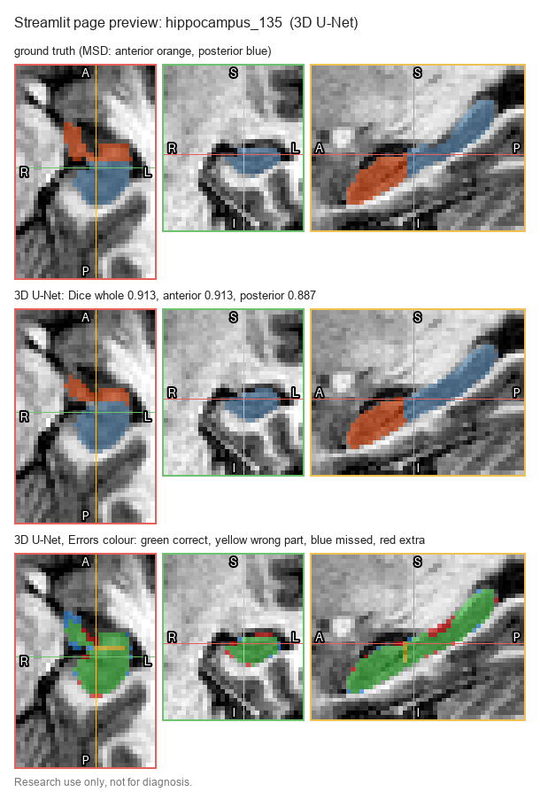
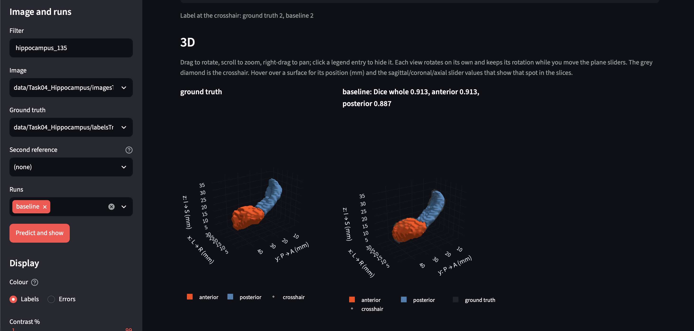
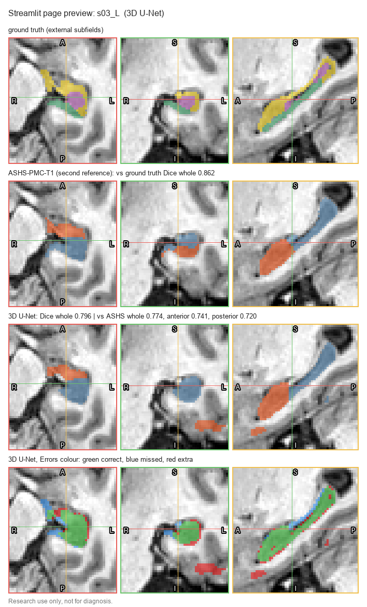
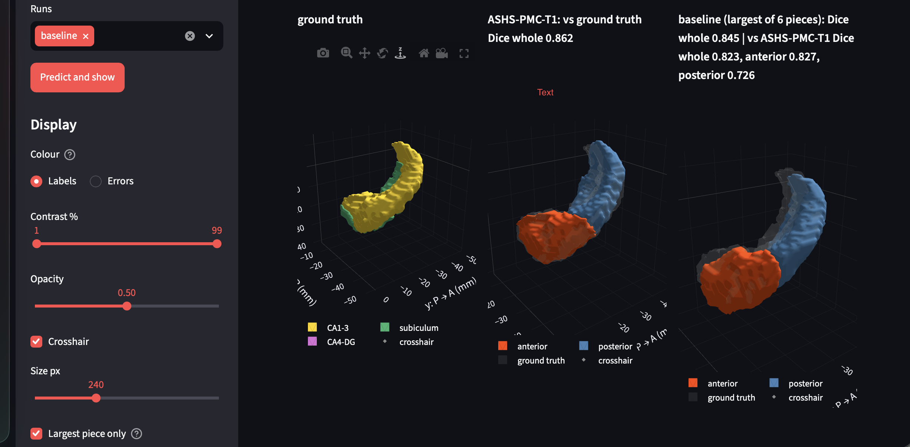

# Streamlit viewer

Research use only, not for diagnosis. Back to the [README](../README.md).

The viewer shows a scan, its manual label and each model's prediction slice by slice (axial, coronal, sagittal, as in 3D Slicer) and in 3D, with Dice in each row title.

```bash
PYTHONPATH=src .venv/bin/streamlit run streamlit_dashboard/compare_slices.py     # then open http://localhost:8501
```

It needs a trained model in `runs/` and the data in `data/` (see [usage](usage.md)).

## How to navigate

1. **Pick an image** in the sidebar. Type in **Filter** to narrow the list, e.g. `hippocampus_135` (MSD) or `s03_L` (external). The ground truth next to it is picked automatically.
2. **Pick the runs** to compare (all trained runs are ticked by default) and click **Predict and show**. Each run predicts with its own preprocessing.
3. **Move through the scan** with the three plane sliders (axial red, coronal green, sagittal yellow). They move the same slice in every row: ground truth first, then an optional second reference, then each run.
4. **Switch Colour** between **Labels** (anterior orange, posterior blue; external subfields gold, green and purple) and **Errors** (green correct, yellow wrong part, blue missed, red extra).
5. **Open 3D** with **3D surfaces**: rotatable surfaces with the ground truth as a grey ghost; hovering shows the position in mm and the slider values for that spot.

Other controls:
- **Largest piece only:** applies the post-processing, for external crops only (where the islands are). It is greyed out for MSD images, whose results always use the plain prediction.
- **Second reference:** another label file shown as its own row. For s03 and s17, the ASHS anterior/posterior labels are picked automatically, and each run's title then also gives its Dice against ASHS.
- **Contrast, opacity, size, crosshair:** display settings only.

Only crops are listed (MSD and external crops); whole-brain scans are not, because the model expects crops. Open those in ITK-SNAP or 3D Slicer.

## In distribution: MSD test

**Slices** (test case hippocampus_135):



*Rows, top to bottom: MSD label (orange anterior, blue posterior); 3D U-Net prediction (Dice whole 0.913, anterior 0.913, posterior 0.887); errors per part (green correct, yellow wrong part at the front/back boundary, blue missed, red extra). Plain prediction, no post-processing.*

**3D surfaces** (same test case):



*Left: MSD label. Right: 3D U-Net prediction, with the label as a grey ghost (Dice whole 0.913, anterior 0.913, posterior 0.887). Plain prediction, no post-processing.*

## External: MNI-HISUB25

**Slices** (case s03_L):



*Rows, top to bottom: manual label (gold CA1-3, green subiculum, purple CA4-DG); ASHS-PMC-T1 as the second reference (orange anterior, blue posterior; Dice 0.862 vs the manual label); 3D U-Net prediction (Dice 0.796); errors vs the manual label (green correct, blue missed, red extra). The red patch below the hippocampus in the coronal view is one of the islands that "Largest piece only" removes.*

**3D surfaces** (same case, "Largest piece only" ticked):



*Left to right: manual label; ASHS-PMC-T1; 3D U-Net largest piece, with the manual label as a grey ghost (Dice 0.845 vs the manual label; vs ASHS 0.823 whole, 0.827 anterior, 0.726 posterior).*

*The slice figures are drawn with the page's own code by `streamlit_dashboard/make_preview.py` (`--case hippocampus_135 --out docs/figures/streamlit_preview_msd.png` for MSD); the 3D figures are browser screenshots.*
